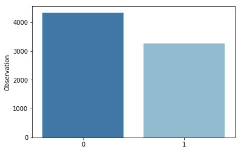
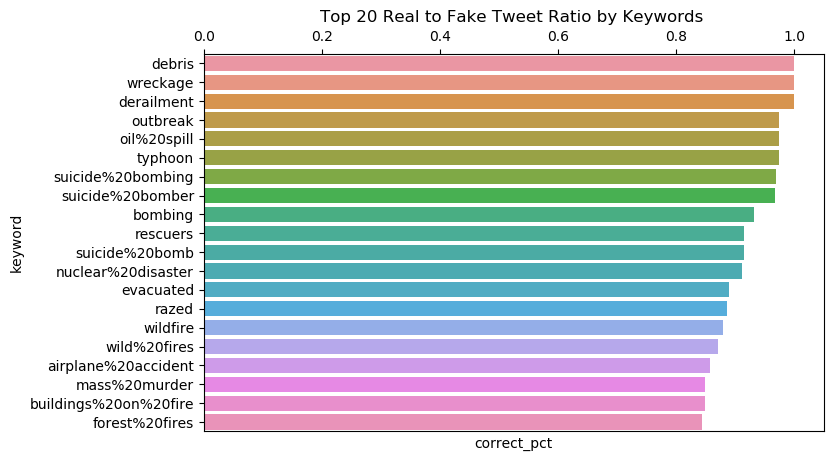
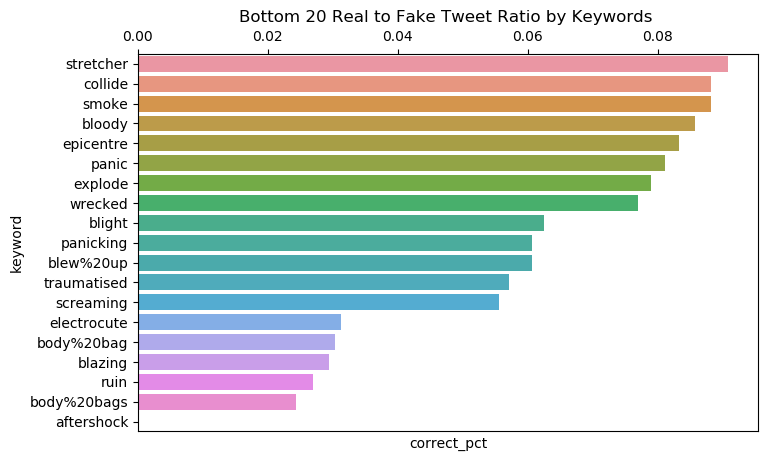
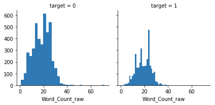
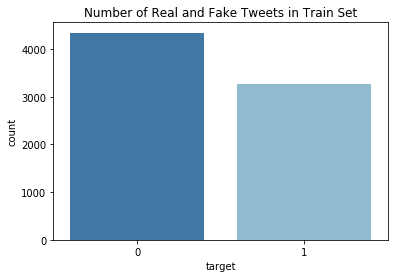
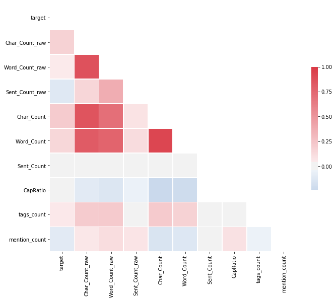
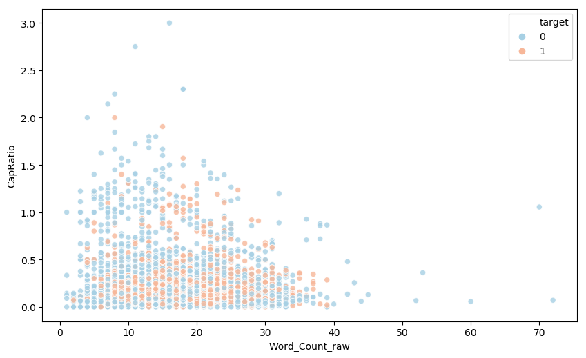
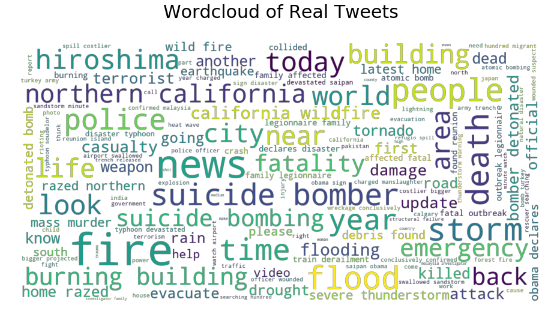
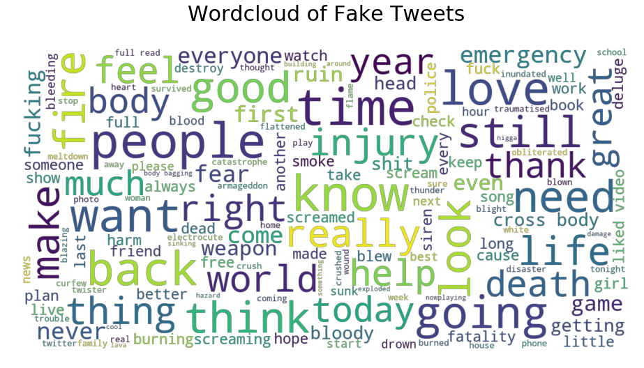

```python
# This Python 3 environment comes with many helpful analytics libraries installed
# It is defined by the kaggle/python docker image: https://github.com/kaggle/docker-python
# For example, here's several helpful packages to load in

import numpy as np # linear algebra
import pandas as pd # data processing, CSV file I/O (e.g. pd.read_csv)

# Input data files are available in the "../input/" directory.
# For example, running this (by clicking run or pressing Shift+Enter) will list all files under the input directory

import os
for dirname, _, filenames in os.walk('/kaggle/input'):
    for filename in filenames:
        print(os.path.join(dirname, filename))

# Any results you write to the current directory are saved as output.
```

    /kaggle/input/nlp-getting-started/train.csv
    /kaggle/input/nlp-getting-started/sample_submission.csv
    /kaggle/input/nlp-getting-started/test.csv


```python
# Import datasets
import pandas as pd
submission = pd.read_csv("../input/nlp-getting-started/sample_submission.csv")
test = pd.read_csv("../input/nlp-getting-started/test.csv")
train = pd.read_csv("../input/nlp-getting-started/train.csv")
```


```python
# Change Pandas Setting to show more columns and rows
pd.set_option('display.max_rows', 500)
pd.set_option('display.max_columns', 500)
pd.set_option('display.max_colwidth', 100)
```

# EDA


```python
# Check size of our data
print(f'Training Set has {train.shape[0]} rows and {train.shape[1]} columns which are {train.columns.values}.')
print(f'\nTest Set has {test.shape[0]} rows and {test.shape[1]} columns which are {test.columns.values}.')

```

    Training Set has 7613 rows and 5 columns which are ['id' 'keyword' 'location' 'text' 'target'].

    Test Set has 3263 rows and 4 columns which are ['id' 'keyword' 'location' 'text'].


```python
# Missing Value
print('Train Set % Missing Values:\n',(train.isnull().sum()*100/len(train)).sort_values(ascending=False))
print('Test Set % Missing Values:\n',(test.isnull().sum()*100/len(test)).sort_values(ascending=False))
print(f'Unique values in Location: {train["location"].nunique()} over {train["location"].notnull().sum()} nonmissing observations in Train Set and {test["location"].nunique()} over {test["location"].notnull().sum()} nonmissing observations in Test Set' )
print(f'Unique values in Location: {train["keyword"].nunique()} over {train["keyword"].notnull().sum()} nonmissing observations in Train Set and {test["keyword"].nunique()} over {test["keyword"].notnull().sum()} nonmissing observations in Test Set' )


```

    Train Set % Missing Values:
     location    33.272035
    keyword      0.801261
    target       0.000000
    text         0.000000
    id           0.000000
    dtype: float64
    Test Set % Missing Values:
     location    33.864542
    keyword      0.796813
    text         0.000000
    id           0.000000
    dtype: float64
    Unique values in Location: 3341 over 5080 nonmissing observations in Train Set and 1602 over 2158 nonmissing observations in Test Set
    Unique values in Location: 221 over 7552 nonmissing observations in Train Set and 221 over 3237 nonmissing observations in Test Set

Location has about 33% observations without information. There are too many unique values comparing to number of observation. Since location is less likely to have correlation with real or fake disaster tweets, it is safe to remove it from the analysis.

```python
%matplotlib inline
import seaborn as sns
import matplotlib.pyplot as plt
```


```python
x=train['target'].value_counts()
sns.barplot(x.index,x)
plt.gca().set_ylabel('Observation')
```


    Text(0, 0.5, 'Observation')





### Keyword Feature


```python
diverging_colors = sns.color_palette("RdBu", 10)
sns.set_palette(diverging_colors)

# Compute and sort real/fake ratio for each keyword
keyword_df = train[['id','keyword','target']].copy()
keyword_df['correct_pct'] = keyword_df.groupby('keyword')['target'].transform('mean')
keyword_df = keyword_df.drop_duplicates('keyword').sort_values('correct_pct', ascending=False)

# Plot top 50 keywords
fig = plt.figure(figsize=(8, 5), dpi=100)

ax = sns.barplot(y='keyword', x='correct_pct',data=keyword_df.iloc[:20])
ax.xaxis.set_ticks_position('top')
ax.set_title('Top 20 Real to Fake Tweet Ratio by Keywords ')
plt.show()

fig = plt.figure(figsize=(8, 5), dpi=100)
ax = sns.barplot(y='keyword', x='correct_pct',data=keyword_df.iloc[-20:])
ax.xaxis.set_ticks_position('top')
ax.set_title('Bottom 20 Real to Fake Tweet Ratio by Keywords ')
plt.show()
```








# Cleaning Up datasets

We will use **NLTK** and **Re** for cleaning the tweets and create some features.


```python
# Import NLTK package and Regex for cleaning
from nltk.corpus import stopwords
from nltk.tokenize import word_tokenize, sent_tokenize
from nltk.stem import WordNetLemmatizer
from nltk.tokenize import wordpunct_tokenize
import re

lemmatizer = WordNetLemmatizer().lemmatize   
stop_words = set(stopwords.words('english'))

```

First, we need to create some functions to do the tasks.
* *findkeyword* to find inputted charactor ( i.e #, @) in text then return 3 values: True if found the key, string after the key, number of key in text.
* *clean_text* to remove stopwords, links, mentions from tweets
* *addFeatures* create additional features from tweets such as word count, sentence count, ratio of capital letters.


```python
def findkeyword(keyword, text):
    key = keyword + '.*?( |$)'
    found = re.search(key, text)
    strings = re.findall(keyword + r'(\w+)', text)
    count = len(strings)
    return bool(found), ' '.join(strings), count

# Remove puntuation, url links, remove stopwords then tokenize text
def clean_text(text, fix_spelling=False):
    text = re.sub(r'http.*?( |$)', '', text)
    text = re.sub(r'@.*?( |$)', '', text)
    text = re.sub(r'[^(a-zA-Z)\s]','  ',text)
    #text = p.clean(text)
    text = text.lower()
    tokens = word_tokenize(text)
    if fix_spelling:
        tokenized = [lemmatizer(SpellChecker().correction(w)) for w in tokens if not w in stop_words]
    else:
        tokenized = [lemmatizer(w) for w in tokens if not w in stop_words]
    return ' '.join(tokenized)

def addFeatures(data):
    df = data.copy()
    df['clean_text'] = df['text'].map(clean_text)
    df['Char_Count_raw'] = df['text'].map(len)
    df['Word_Count_raw'] = df['text'].map(lambda x: len(word_tokenize(x)))
    df['Sent_Count_raw'] = df['text'].map(lambda x: len(sent_tokenize(x)))
    df['Char_Count'] = df['clean_text'].map(len)
    df['Word_Count'] = df['clean_text'].map(lambda x: len(word_tokenize(x)))
    df['Sent_Count'] = df['clean_text'].map(lambda x: len(sent_tokenize(x)))
    df['CapRatio']=df['text'].map(lambda x: len(re.findall(r'[A-Z]', x))) / df['Char_Count']
    df[['hasTag','hashtags','tags_count']] = df['text'].apply(lambda x: pd.Series(findkeyword('#',x)))
    df[['hasMention','mentions','mention_count']] = df['text'].apply(lambda x: pd.Series(findkeyword('@',x)))

    return df

```


```python
train = addFeatures(train)
train.head(5)
```


<div>
<style scoped>
    .dataframe tbody tr th:only-of-type {
        vertical-align: middle;
    }

    .dataframe tbody tr th {
        vertical-align: top;
    }

    .dataframe thead th {
        text-align: right;
    }
</style>
<table border="1" class="dataframe">
  <thead>
    <tr style="text-align: right;">
      <th></th>
      <th>id</th>
      <th>keyword</th>
      <th>location</th>
      <th>text</th>
      <th>target</th>
      <th>clean_text</th>
      <th>Char_Count_raw</th>
      <th>Word_Count_raw</th>
      <th>Sent_Count_raw</th>
      <th>Char_Count</th>
      <th>Word_Count</th>
      <th>Sent_Count</th>
      <th>CapRatio</th>
      <th>hasTag</th>
      <th>hashtags</th>
      <th>tags_count</th>
      <th>hasMention</th>
      <th>mentions</th>
      <th>mention_count</th>
    </tr>
  </thead>
  <tbody>
    <tr>
      <th>0</th>
      <td>1</td>
      <td>NaN</td>
      <td>NaN</td>
      <td>Our Deeds are the Reason of this #earthquake May ALLAH Forgive us all</td>
      <td>1</td>
      <td>deed reason earthquake may allah forgive u</td>
      <td>69</td>
      <td>14</td>
      <td>1</td>
      <td>42</td>
      <td>7</td>
      <td>1</td>
      <td>0.238095</td>
      <td>True</td>
      <td>earthquake</td>
      <td>1</td>
      <td>False</td>
      <td></td>
      <td>0</td>
    </tr>
    <tr>
      <th>1</th>
      <td>4</td>
      <td>NaN</td>
      <td>NaN</td>
      <td>Forest fire near La Ronge Sask. Canada</td>
      <td>1</td>
      <td>forest fire near la ronge sask canada</td>
      <td>38</td>
      <td>8</td>
      <td>2</td>
      <td>37</td>
      <td>7</td>
      <td>1</td>
      <td>0.135135</td>
      <td>False</td>
      <td></td>
      <td>0</td>
      <td>False</td>
      <td></td>
      <td>0</td>
    </tr>
    <tr>
      <th>2</th>
      <td>5</td>
      <td>NaN</td>
      <td>NaN</td>
      <td>All residents asked to 'shelter in place' are being notified by officers. No other evacuation or...</td>
      <td>1</td>
      <td>resident asked shelter place notified officer evacuation shelter place order expected</td>
      <td>133</td>
      <td>24</td>
      <td>2</td>
      <td>85</td>
      <td>11</td>
      <td>1</td>
      <td>0.023529</td>
      <td>False</td>
      <td></td>
      <td>0</td>
      <td>False</td>
      <td></td>
      <td>0</td>
    </tr>
    <tr>
      <th>3</th>
      <td>6</td>
      <td>NaN</td>
      <td>NaN</td>
      <td>13,000 people receive #wildfires evacuation orders in California</td>
      <td>1</td>
      <td>people receive wildfire evacuation order california</td>
      <td>65</td>
      <td>9</td>
      <td>1</td>
      <td>51</td>
      <td>6</td>
      <td>1</td>
      <td>0.019608</td>
      <td>True</td>
      <td>wildfires</td>
      <td>1</td>
      <td>False</td>
      <td></td>
      <td>0</td>
    </tr>
    <tr>
      <th>4</th>
      <td>7</td>
      <td>NaN</td>
      <td>NaN</td>
      <td>Just got sent this photo from Ruby #Alaska as smoke from #wildfires pours into a school</td>
      <td>1</td>
      <td>got sent photo ruby alaska smoke wildfire pours school</td>
      <td>88</td>
      <td>18</td>
      <td>1</td>
      <td>54</td>
      <td>9</td>
      <td>1</td>
      <td>0.055556</td>
      <td>True</td>
      <td>Alaska wildfires</td>
      <td>2</td>
      <td>False</td>
      <td></td>
      <td>0</td>
    </tr>
  </tbody>
</table>
</div>


```python
# Test cleaning process
for i in np.random.randint(train.shape[0], size=5):
    print(f'Raw: {train["text"][i]}.\nCleaned: {train["clean_text"][i]}\n')

```

    Raw: #WorldNews Fallen powerlines on G:link tram: UPDATE: FIRE crews have evacuated up to 30 passengers who were tr... http://t.co/EYSVvzA7Qm.
    Cleaned: worldnews fallen powerlines g link tram update fire crew evacuated passenger tr

    Raw: It's never a good sign when you pull up to work &amp; there's five ambulances &amp; a fire truck in the bay. Wompppp at least it's Friday.
    Cleaned: never good sign pull work amp five ambulance amp fire truck bay wompppp least friday

    Raw: Plains: Calif. Oil Spill Could be Larger than Estimated. http://t.co/CcvcTe3lCw.
    Cleaned: plain calif oil spill could larger estimated

    Raw: Trains derailment: 'It's the freakiest of freak accidents' - The Indian Express http://t.co/CUVKf5YKAX.
    Cleaned: train derailment freakiest freak accident indian express

    Raw: I'm setting myself up for disaster.
    Cleaned: setting disaster


```python
sns.set_palette('RdBu_r')

fig = sns.FacetGrid(train, col="target")
fig.map(plt.hist, "Word_Count_raw", bins=30);
```





```python
ax = sns.countplot(x="target", data=train)
ax.set_title('Number of Real and Fake Tweets in Train Set')
plt.show()

```





## Correlation Table

We can create a corrlation table then use **Seaborn HeatMap** to graph it.
Based on the heatmap, we can see that *Char_Count_raw* which is the number of letter in original tweets is higly correlated with word count and sentence count.
This is expected but we shouldn't include all those variables in the model.


```python
num_cols = ['target','Char_Count_raw', 'Word_Count_raw', 'Sent_Count_raw', 'Char_Count', 'Word_Count', 'Sent_Count', 'CapRatio', 'tags_count',  'mention_count']

# Compute the correlation matrix
corr = train[num_cols].corr()

# Generate a mask for the upper triangle
mask = np.zeros_like(corr, dtype=np.bool)
mask[np.triu_indices_from(mask)] = True

# Set up the matplotlib figure
fig, ax = plt.subplots(figsize=(11, 9))

# Generate a custom diverging colormap
cmap = sns.diverging_palette(250, 10, as_cmap=True)

# Draw the heatmap
sns.heatmap(corr, mask=mask, cmap=cmap,  center=0,
            square=True, linewidths=.5, cbar_kws={"shrink": .5});
```





```python
fig = plt.figure(figsize=(10, 6), dpi=100)
ax = sns.scatterplot(x="Word_Count_raw", y="CapRatio", data=train, hue='target', palette='RdBu_r',  alpha=.8)
```





## WordCloud

Create a word cloud of our cleaned text using **wordcloud**. First, we need to merge all strings in *train['clean_text']* into one. Then, we can use wordcloud to generate a graph.


```python
# Import wordcloud
from wordcloud import WordCloud

# Join text
realtw = train[train['target']==1]
faketw = train[train['target']==0]
text = ' '.join(realtw['clean_text'].values.tolist())

# Create wordcloud
wordcloud = WordCloud(max_font_size=100, max_words=150,font_step=2,
                      background_color=None, mode='RGBA',colormap ='viridis',
                      min_word_length =4, width=1200, height=600).generate(text)

# Display
plt.figure(figsize=(16,8))
plt.imshow(wordcloud, interpolation='bilinear')
plt.axis("off")
plt.title('Wordcloud of Real Tweets\n', fontdict = {'fontsize' : 30})
plt.show()
```





Similarty, we can create a wordcloud for fake tweets.


```python
text = ' '.join(faketw['clean_text'].values.tolist())

# Create wordcloud
wordcloud = WordCloud(max_font_size=100, max_words=150,font_step=2,
                      background_color=None, mode='RGBA',colormap ='viridis',
                      min_word_length =4, width=1200, height=600).generate(text)

# Display
plt.figure(figsize=(16,8))
plt.imshow(wordcloud, interpolation='bilinear')
plt.axis("off")
plt.title('Wordcloud of Fake Tweets\n', fontdict = {'fontsize' : 30})
plt.show()
```





We can see in the Real Tweet wordcloud, some words such as *fire, flood, storm, news, fatality* appear.

## Preparing for deep learning


```python
# Create a function to transform a dataset to usable format
# Drop irrelevant columns, apply the clean_text function to the text column, seperate feature and label columns
# Return X, y
def transform_data(data, text_col, label):
    x = data[text_col]
    if label in data:
        y = data[label]
    else:
        y = None
    return x, y
```


```python
# Transform train and test dataframe
X, y = transform_data(train, 'text','target')
X_test, _ = transform_data(test, 'text','target')
```


```python
# Split X into train and validation sets

from sklearn.model_selection import train_test_split

X_train, X_valid, y_train, y_valid = train_test_split(X, y, random_state = 777, test_size = 0.2)
```


```python
# Hyperparameters
vocab_size = 100000    # max no. of words for tokenizer
max_length = 200 # max length of each entry (sentence), including padding
VALIDATION_SPLIT = 0.2   # data for validation (not used in training)
embedding_dim = 100      # embedding dimensions for word vectors (word2vec/GloVe)
GLOVE_DIR = "../input/glove-global-vectors-for-word-representation/glove.twitter.27B."+str(embedding_dim)+"d.txt"
```


```python
from tensorflow.keras.preprocessing.text import Tokenizer
from tensorflow.keras.preprocessing.sequence import pad_sequences

def padding_text(X,vocab_size,max_length,padding_type='post',trunc_type='post'):
    corpus = X.values.tolist()
    #print(corpus[:20])
    X_seq = tokenizer.texts_to_sequences(corpus)
    X_padd = pad_sequences(X_seq, maxlen= max_length, padding=padding_type, truncating=trunc_type)
    return X_padd

# Create corpus of all tweets in the train set
corpus_train = X_train.values.tolist()
tokenizer = Tokenizer(num_words=vocab_size, oov_token='<oov>')
tokenizer.fit_on_texts(corpus_train)
word_index = tokenizer.word_index
print('Vocabulary size:', len(word_index))

# Map words to numbers
# Padding Text
X_train_padd = padding_text(X_train,vocab_size,max_length)
X_valid_padd = padding_text(X_valid,vocab_size,max_length)
X_test_padd = padding_text(X_test,vocab_size,max_length)

print('Shape of train set tensor:', X_train_padd.shape)
print('Shape of train label tensor:', y_train.shape)
print('Shape of validation set tensor:', X_valid_padd.shape)
print('Shape of validation label tensor:', y_valid.shape)
```


```python
embeddings_index = {}
f = open(GLOVE_DIR)
print('Loading GloVe from:', GLOVE_DIR,'...', end='\n')
for line in f:
    values = line.split()
    word = values[0]
    embeddings_index[word] = np.asarray(values[1:], dtype='float32')
f.close()
print("Done.\n\nProceeding with Embedding Matrix...", end="\n")

embedding_matrix = np.random.random((len(word_index) + 1, embedding_dim))
for word, i in word_index.items():
    embedding_vector = embeddings_index.get(word)
    if embedding_vector is not None:
        embedding_matrix[i] = embedding_vector
print("Completed!")
```


```python
# Create F1 score function for model metric

import keras.backend as K

def f1_score_keras(y_true, y_pred): #taken from old keras source code
    true_positives = K.sum(K.round(K.clip(y_true * y_pred, 0, 1)))
    possible_positives = K.sum(K.round(K.clip(y_true, 0, 1)))
    predicted_positives = K.sum(K.round(K.clip(y_pred, 0, 1)))
    precision = true_positives / (predicted_positives + K.epsilon())
    recall = true_positives / (possible_positives + K.epsilon())
    f1_val = 2*(precision*recall)/(precision+recall+K.epsilon())
    return f1_val
```


```python
import tensorflow as tf
from tensorflow.keras.layers import Embedding, Bidirectional, Dropout, Dense, LSTM
#from tensorflow import keras
# Model Definition with LSTM

def create_model():
    model = tf.keras.Sequential([
        Embedding(len(word_index) + 1, embedding_dim,weights = [embedding_matrix],
                                  input_length=max_length, trainable=False, name = 'embeddings'),
        Bidirectional(LSTM(64)),
        Dropout(0.2),
        Dense(50, activation='relu'),
        Dropout(0.2),

        Dense(1, activation='sigmoid')  # remember this is a binary clasification
    ])
    return model

model = create_model()
model.compile(loss='binary_crossentropy',optimizer='adam',metrics=[f1_score_keras])
#######
```


```python
import time
start_time = time.time()

num_epochs = 10
history = model.fit(X_train_padd, y_train, epochs=num_epochs, validation_data=(X_valid_padd, y_valid))

final_time = (time.time()- start_time)/60
print(f'The time in minutes: {final_time}')
```

# Model Validation


```python
model_loss = pd.DataFrame(model.history.history)
model_loss.head()
```


```python
model_loss[['f1_score_keras','val_f1_score_keras']].plot(ylim=[0,1]);
```


```python
model.evaluate(X_valid_padd, y_valid)
```


```python
from sklearn.metrics import f1_score
pred = model.predict_classes(X_valid_padd)   # predict_ clases because is classification problem with the split test
f1_score(y_valid, pred)
```


```python
##  Hyperparameters Optimization using Bayesian OP
```


```python
from bayes_opt import BayesianOptimization
from keras.optimizers import Adam

def create_model():
    model = tf.keras.Sequential([
        Embedding(len(word_index) + 1, embedding_dim,weights = [embedding_matrix],
                                  input_length=max_length, trainable=False, name = 'embeddings'),
        Bidirectional(LSTM(64)),
        Dropout(0.2),
        Dense(50, activation='relu'),
        Dropout(0.2),

        Dense(1, activation='sigmoid')  # remember this is a binary clasification
    ])
    return model

def model_eval(learning_rate, num_input_nodes, adam_decay,num_dense_layers,num_dense_nodes, drop_out,lstm_nodes,max_length):#, embedding_dim, vocab_size,):

    X_train_padd = padding_text(X_train,int(vocab_size),int(max_length))
    X_valid_padd = padding_text(X_valid,int(vocab_size),int(max_length))

    model = tf.keras.Sequential([
        Embedding(len(word_index) + 1, embedding_dim,weights = [embedding_matrix],
                    input_length=int(max_length), trainable=False, name = 'embeddings'),
        Bidirectional(LSTM(int(lstm_nodes))),
        Dropout(drop_out)
        ])

    for i in range(int(num_dense_layers)):
        name = 'layer_dense_{0}'.format(i+1)
        model.add(Dense(int(num_dense_nodes),
                 activation='relu',
                        name=name
                 ))
        model.add(Dropout(drop_out))

    model.add(Dense(1, activation='sigmoid'))

    #setup our optimizer and compile
    adam = Adam(lr=learning_rate, decay= adam_decay)
    model.compile(loss='binary_crossentropy',optimizer='adam',metrics=[f1_score_keras])

    num_epochs = 5
    history = model.fit(X_train_padd, y_train, epochs=num_epochs, validation_data=(X_valid_padd, y_valid), verbose=1)

    pred = model.predict_classes(X_valid_padd)
    f1_val = f1_score(y_valid, pred)
    return f1_val
```


```python
max_length
```


```python
Model_BO = BayesianOptimization(model_eval, {'learning_rate':(1e-4,1e-2), 'num_dense_layers':(1,5),
                                            'num_input_nodes':(1,512), 'num_dense_nodes':(1,100),
                                            'adam_decay':(1e-6,1e-2), 'drop_out':(0,0.9), 'lstm_nodes':(64,200),
                                             'max_length':(1,200)
                                            })
```


```python
Model_BO.maximize(n_iter=2, init_points=2)
```


```python
model_eval(0.001,100,0.1,10,50,0.2,64,200)
```


```python

```
