Coronavirus disease 2019 (COVID-19) is an infectious disease caused by
severe acute respiratory syndrome coronavirus 2. It was first identified
in December 2019 in Wuhan, and has since spread globally, resulting in
an ongoing pandemic. As of 30 April 2020, more than 3.2 million cases
have been reported across 198 countries and territories, resulting in
more than 227,000 deaths. Because of the high co-infection rate and high
fatality rate, lots of countries and states are currently in some degree
of “lockdown,” with restaurants and bars, shops, schools and gyms
closed, and citizens required, or at least strongly encouraged, to stay
home to avoid catching or spreading COVID-19.

In this post, I investigate what characteristics affect the time for the
local government to lockdown. I expect region, population, GDP, test,
and trace affect time to lockdown.

# 1\. Data

## Overview

The data were from following sources: + COVID-19 dataset from Johns
Hopkins School of Public Healthy + Lockdown data from Aura Vision which
provides quarantine timelines and durations for countries. + Country
characteristics from CIA factbook.The World Factbook provides
information on the people, society, economy, geography, and
transportation issues for 267 world entities. + Government response
tracker from Blavatnik School of Government, University of
Oxford.Publicly available information on 17 indicators of government
responses such as testing data and tracing data are collected.

Required R packages for this analysis.

``` r
require(survival)
require(survminer)
require(geosphere)
require(readxl)
require(tidyverse)
require(ggplot2)
require(ggrepel)
require(zoo)
```

``` r
data <- read.csv("data-final.csv", header = T)

data <- data %>% select(-X) %>% rename(test = test1_to_1death,
                                       trace = trace1_to_1death,
                                       test.trace = test_or_trace_to_1death)
head(
  data %>% select(
    Country, lockdown,
    days_to_lockdown,
    case_on_lockdown,
    death, life, GDP,
    region, gini
  )
)
```

    ##               Country   lockdown days_to_lockdown case_on_lockdown death life
    ## 1         Afghanistan 2020-04-15               51              784    25 52.8
    ## 2             Albania 2020-03-13                4               33     1 79.0
    ## 3             Algeria 2020-03-23               27              230    17 77.5
    ## 4             Andorra 2020-04-15               44              673    33 83.0
    ## 5              Angola 2020-04-15               26               19     2 61.3
    ## 6 Antigua and Barbuda 2020-04-15               33               23     2 77.3
    ##     GDP   region gini
    ## 1  2000     Asia 27.8
    ## 2 12500   Europe 34.5
    ## 3 15200   Africa 35.3
    ## 4 49900   Europe   NA
    ## 5  6800   Africa 58.6
    ## 6 26400 Americas   NA

For this analysis, seventeen variables are extracted from the databases,
including COVID-19 data, livelihoods, economies, geographies, and
policies for 180 countries. Definitions of some variables are explained
as follows: + days\_to\_lockdown is our response variable. It measures
the time that countries take to lockdown. It is the days from the date
of the first case to the date of lockdown. + censor is an indicator
variable which equals “0” if survival time is censored, while “1”
indicates we observed the event. The Type 1 right censoring is adopted
in this analysis, in which the lockdown event is observed if it occurs
before April 15, 2020. + test equals date of coronavirus testing applied
minus date of the first death. This time span is calculated to evaluate
how quickly governments start testing coronavirus during COVID-19
spreading. + life is the life expectancy at birth, which measure time
people in a country expected to live. + gini measures the economic
inequality.

## Descriptive statistics

``` r
summary(
  data %>% select(
    Country, lockdown, days_to_lockdown,
    case_on_lockdown, death, life, GDP,
    region, gini
  )
)
```

    ##                 Country          lockdown  days_to_lockdown case_on_lockdown  
    ##  Palestine, State of:  2   2020-04-15:88   Min.   : 1.00    Min.   :    1.00  
    ##  Afghanistan        :  1   2020-03-24:10   1st Qu.:17.00    1st Qu.:   22.75  
    ##  Albania            :  1   2020-03-23: 8   Median :28.50    Median :  138.00  
    ##  Algeria            :  1   2020-03-17: 7   Mean   :30.06    Mean   : 1378.12  
    ##  Andorra            :  1   2020-03-16: 6   3rd Qu.:39.25    3rd Qu.:  732.25  
    ##  Angola             :  1   2020-03-13: 5   Max.   :84.00    Max.   :52167.00  
    ##  (Other)            :173   (Other)   :56                                      
    ##      death              life            GDP              region  
    ##  Min.   :   0.00   Min.   :52.80   Min.   :   700   Africa  :52  
    ##  1st Qu.:   0.00   1st Qu.:67.40   1st Qu.:  4700   Americas:34  
    ##  Median :   2.00   Median :74.90   Median : 13700   Asia    :45  
    ##  Mean   :  42.49   Mean   :73.12   Mean   : 22418   Europe  :45  
    ##  3rd Qu.:   8.25   3rd Qu.:78.40   3rd Qu.: 31700   Oceania : 4  
    ##  Max.   :1934.00   Max.   :89.30   Max.   :139100                
    ##                    NA's   :1       NA's   :3                     
    ##       gini      
    ##  Min.   :24.00  
    ##  1st Qu.:33.55  
    ##  Median :38.20  
    ##  Mean   :39.77  
    ##  3rd Qu.:45.15  
    ##  Max.   :65.80  
    ##  NA's   :33

Countries take 30 days in average to order lockdown with a minimum of 1
day and maximum of 84 days. Those countries with 84 days to lockdown are
the ones censored in our data. I observe the event for about 50% of the
countries in the full data. Some variables have larger scales than
others, we can take log transformation for them in following analysis.

# 2\. EDA

In this section, we will explore the data with different visualization
methods, in order to set up the statistical model appropriately. Only
some interesting plots are shown to make sure the post doesn’t get too
long.

``` r
# Specify countries in the top and bottom quantiles in term of days to lockdown.
countries_of_interest <-
  subset(data, days_to_lockdown > 60 | case_on_lockdown < 2)
```

## 2.1 Scatter Plots

**Cases vs days**

This plot is reasonnable since the the cases should increase as time
goes by.

``` r
ggplot(data,
       aes(
         days_to_lockdown,
         log(case_on_lockdown),
         color = region,
         shape = as.factor(censor)
       )) +
  geom_point() +
  geom_text_repel(data = countries_of_interest, aes(label = Country)) +
  theme_classic()
```

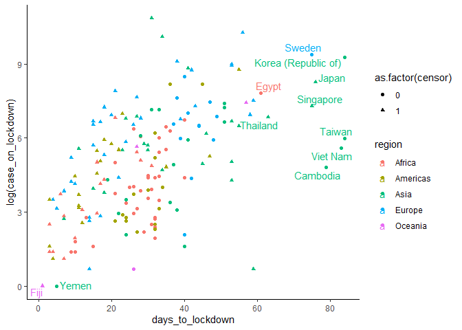<!-- -->

**Test or trace vs days**

``` r
ggplot(data,
       mapping = aes(
         days_to_lockdown,
         test.trace,
         color = region,
         shape = as.factor(censor)
       )) +
  geom_point() +
  geom_text_repel(data = countries_of_interest,
                  aes(label = Country)) +
  theme_classic()
```

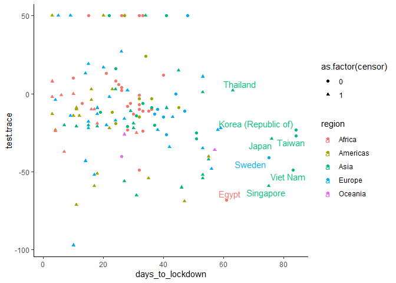<!-- -->

**Life vs days**

The plot indicates country with higher life exeptanacy tend to lockdown
late.

Life expectancy may be a proxy for medical quality in those country. So
if life exp is low, the medical system is bad so they need to lock down
early since they know their hospital can’t handle it.

We can see that Africa countries have low life exp.

``` r
countries_life <-
  subset(data,
         (censor = 1) & (life > 85 | life < 60 |
                           days_to_lockdown > 55 |
                           days_to_lockdown < 2))

ggplot(data, mapping = aes(days_to_lockdown, life, color = region)) +
  geom_point() +
  geom_text_repel(data = countries_life, aes(label = Country)) +
  theme_classic()
```

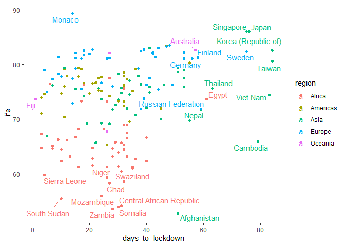<!-- -->

**GDP vs days**

Here, high GDP countries are late to response. Maybe they are more
confident on their ability to deal with the disease or just don’t want
to lockdown since it affects their economy.

``` r
countries_gdp <-
  subset(data,
         (censor = 1) & (
           log(GDP) > 11.5 | log(GDP) < 7 |
             days_to_lockdown > 60 |
             days_to_lockdown < 2
         ))


ggplot(data, mapping = aes(days_to_lockdown, log(GDP), color = region)) +
  geom_point() +
  geom_text_repel(data = countries_gdp, aes(label = Country)) +
  theme_classic()
```

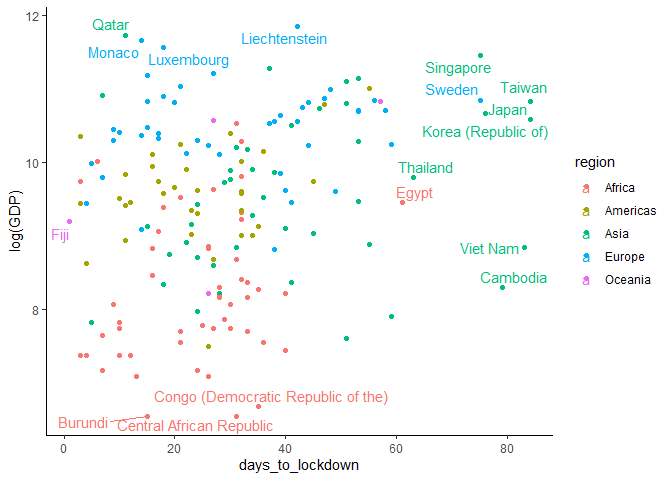<!-- -->

## 2.2 Boxplots

**days by region**

Boxplot of regions indicates that Asian countries has a higher median
days\_to\_lockdown than the rest.

``` r
ggplot(data, aes(y = days_to_lockdown,  fill = region)) +
  geom_boxplot() +
  theme_classic()
```

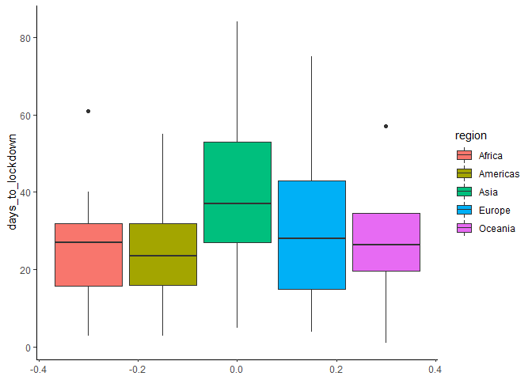<!-- -->

## 2.3 Histogram

**Days to lockdown**

Counts of countries firstly show a broad peak at relatively small
days\_to\_lockdown, then represent a tail at large days\_to\_lockdown.
This typical survival data distribution validates the survival model for
retrospective analysis.

``` r
ggplot(data, aes(x = days_to_lockdown)) + geom_histogram(colour = "black", fill =
                                                           "steelblue4") + theme_bw()
```

    ## `stat_bin()` using `bins = 30`. Pick better value with `binwidth`.

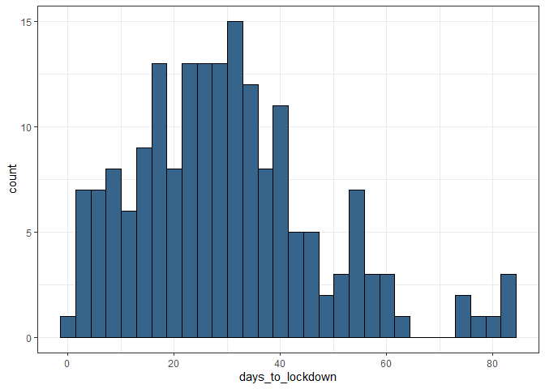<!-- -->

**Population**

``` r
ggplot(data, aes(x = log(population))) + geom_histogram(binwidth = 1,
                                                        color = "black",
                                                        fill = "springgreen4") + theme_bw()
```

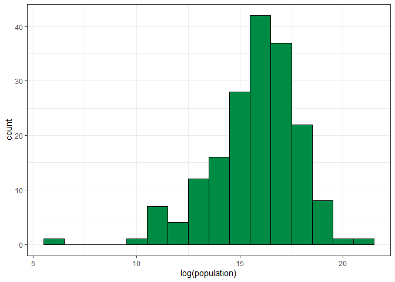<!-- -->

## 2.4 Correlation Heatmap

A correlation heatmap is plotted to explore correlations among
variables. Rail, road, and airports are highly correlated, so we can
expect to only include airports in analysis, since it is less correlated
with other variables. Test, trace, and test.trace are correlated, and we
should only include 1 of them (i.e test.trace) in analysis.

``` r
data.X <- data %>% select(
  population , death, life , GDP ,
  gini , unemployment , median_age ,
  test , trace , test.trace ,
  road, rail, airports
)

correlation.table <- round(cor(data.X, use = "complete.obs"), 1)

ggcorrplot::ggcorrplot(
  correlation.table,
  method = "circle",
  type = "lower",
  outline.col = "white"
)
```

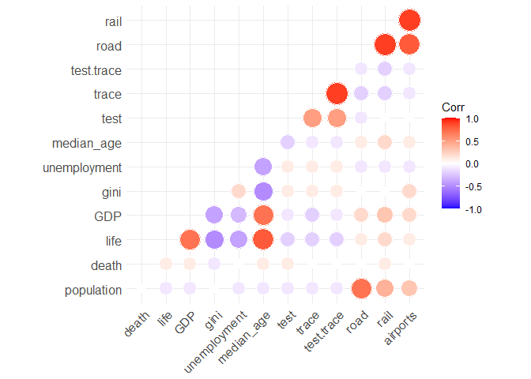<!-- -->

# 3\. Survival analysis

We use survival analysis here due to three reasons. + First, the
response variable, days\_to\_lockdown, is a non-negative discrete
variable. It represents the time from an origin, date of the first
positive COVID, to an event, date of lockdown. + Second, the event in
some countries were not observed. These countries might have the event
after our trial period (Jan 22 to April 15). Thus, we will need to
censor those. + Lastly, survival analysis which focuses on the time
until occurrence of an event will allow us to understand country’s
characteristics that affect its time to lockdown.

R packages: + survival for computing survival analyses + survminer for
visualizing survival analysis results

## 3.1 Univariate Models

First, we can fit some simple models using Kaplan-Meier estimates with
some categorical variables in our data such as region, population size.

### region as a predictor

Here, we test whether region affect the time to lockdown differently.
The log-rank p-value of 0.0088 indicates a significant result. The
region affects the time to lockdown. The survival curves are as follows.

``` r
# Modify data
data$region <- factor(data$region)
data <- na.omit(data %>% select(-rail))

# Fit using the Kaplan-Meier method
surv.obj <-
  Surv(time = data$days_to_lockdown,
       event = as.numeric(data$censor))

region.mod  <- survfit(surv.obj ~ region, data = data)


ggsurvplot(
  region.mod,
  data = data,
  pval = TRUE,
  xlab = 'Days',
  ylab = 'Lockdown Probability'
)
```

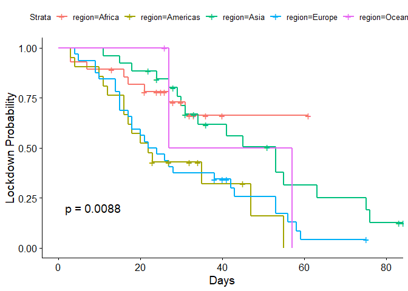<!-- -->

### population as a predictor

We can test whether population size affect the time to lockdown
differently. The p-value is 0.5 which indicates that there is no
different in lockdown probability among high, medium, and low
population.

``` r
# Based on histogram -> split into 3 groups
data$pop.size <- ifelse(log(data$population) > 18,
                        "large",
                        ifelse(log(data$population) < 15, 'small', 'medium'))
# Fit on population size
pop.mod  <- survfit(surv.obj ~ pop.size, data = data)

#summary(pop.mod)

ggsurvplot(
  pop.mod,
  data = data,
  pval = TRUE,
  xlab = 'Days',
  ylab = 'Lockdown Probability'
)
```

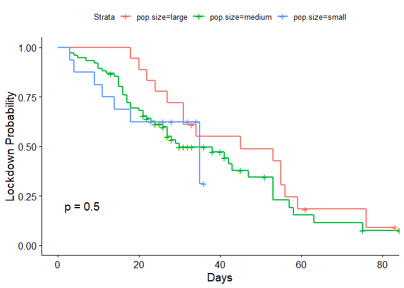<!-- -->

### region with stratification

Here we construct a stratified log rank test to investigate the effect
of region for each level of population size. With the stratification,
region is still significant with a p-value from log rank test of 0.018.
This indicates that region is an important variable and should be
included in our model.

``` r
strata.mod  <-
  survfit(surv.obj ~ region + strata(pop.size), data = data)

ggsurvplot(
  strata.mod,
  data = data,
  pval = TRUE,
  xlab = 'Days',
  ylab = 'Lockdown Probability'
)
```

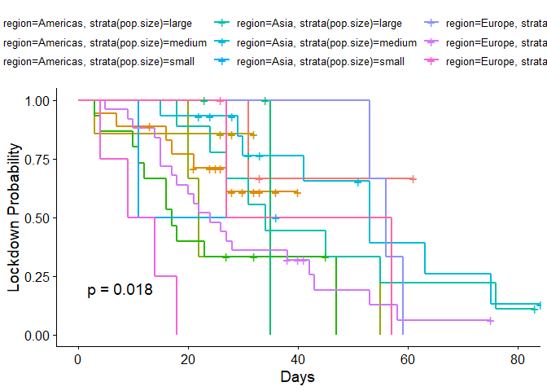<!-- -->

## 3.2 Multivariate Models

### Check linear assumption

Before fitting a model, we check the linearity of our continuous
variables by plotting the Martingale residuals against continuous
covariates. For each plot, we add a fitted line with loess function.
This line should be linear to satisfy the assumption. These plots help
us choose the functional form of our continuous variables.

``` r
# Create function to draw loess line
loessline <- function(y, x) {
  x.list <- min(x) + ((0:100) / 100) * (max(x) - min(x))
  y.x <- predict(loess(y ~ x), se = T, newdata = (x = x.list))
  lines(y.x$fit ~ x.list, lwd = 2, col = "red")
}
```

``` r
# Plot
coxph.null <- coxph(surv.obj ~ 1, data = data)
resid.m.null <- residuals(coxph.null, type = "martingale")

par(mfrow = c(2, 2))
plot(resid.m.null ~ gini, data, ylab = "Martingale Residual")
loessline(resid.m.null, data$gini)

plot(resid.m.null ~ life, data, ylab = "Martingale Residual")
loessline(resid.m.null, data$life)

plot(resid.m.null ~ median_age, data, ylab = "Martingale Residual")
loessline(resid.m.null, data$median_age)

plot(resid.m.null ~ GDP, data, ylab = "Martingale Residual")
loessline(resid.m.null, data$GDP)
```

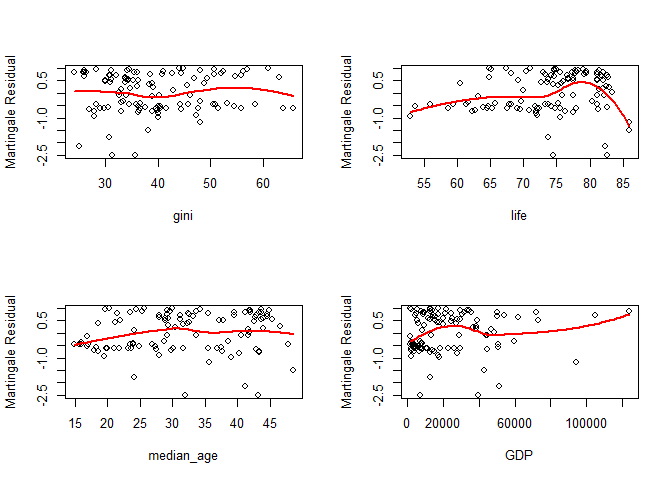<!-- -->

``` r
plot(resid.m.null ~ population, data, ylab = "Martingale Residual")
loessline(resid.m.null, data$population)

plot(resid.m.null ~ test.trace, data, ylab = "Martingale Residual")
loessline(resid.m.null, data$test.trace)

plot(resid.m.null ~ airports, data, ylab = "Martingale Residual")
loessline(resid.m.null, data$airports)
```

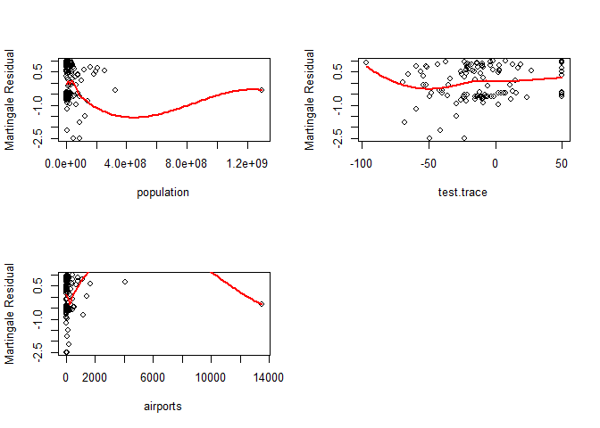<!-- -->

The plots for life, population, airports, GDP show nonlinearity. Hence,
we change those variables using log transformation and check the plots
again. As we can see in below, population and GDP, airports look better
now but we still have issue with life.

``` r
par(mfrow = c(2, 2))

plot(resid.m.null ~ log(population), data)
loessline(resid.m.null, log(data$population))

plot(resid.m.null ~ log(GDP), data)
loessline(resid.m.null, log(data$GDP))

plot(resid.m.null ~ log(airports), data)
loessline(resid.m.null, log(data$airports))

plot(resid.m.null ~ log(life), data)
loessline(resid.m.null, log(data$life))
```

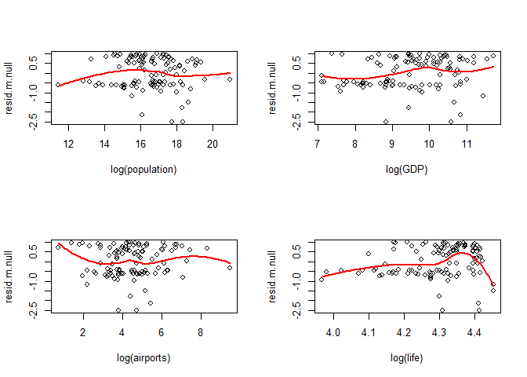<!-- -->

We can try different transformations, i.e. take the square root or
square, to remedy the issue. However, for this analysis, we will convert
life into a categorical variable called life.grp with 3 levels, high if
life is more than 80 and low if less than 60 and middle otherwise.

``` r
data$life.grp <-
  as.factor(ifelse(data$life < 70, "Low", ifelse(data$life > 80, "High", "Medium")))

ggplot(data, aes(y = days_to_lockdown,  fill = life.grp)) +
  geom_boxplot() +
  theme_classic()
```

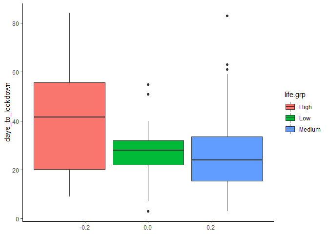<!-- -->

### 3.2.1 Full Model

First, let’s include all variables in the full model. region,
log(population), log(GDP), log(airports) are significant. They affect
the hazard ratio and days to lockdown.

``` r
full.mod <- coxph(
  surv.obj ~ region + log(population)  +
    life.grp + log(GDP) + gini + unemployment +
    median_age + test + trace + test.trace + road + log(airports),
  data = data
)

ggforest(full.mod, data = data)
```

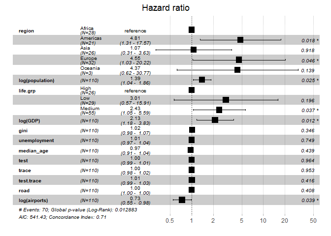<!-- -->

### 3.2.2 Reduced Model

We can see that only some variables are significant in the full model
and we can expect some collinearity there. Thus, we should look at a
less complex model which includes all variables that are significant in
the full model and the test.trace variable.

Although test.trace is not significant in the full model, but we include
it because based on correlation table, we know that test, trace,
test.trace are highly correlated. Thus, including all three in the
models cause multicollinearity and reduce the effect of each variable.
Test.trace is chosen instead of test or trace since it has lowest
p-value and it is a combination of test and trace.

All variables in the reduced model affect the hazard ratio
significantly.

``` r
reduced.mod <- coxph(
  surv.obj ~ region + log(population)
  + log(GDP) + life.grp
  + test.trace + log(airports),
  data = data
)

ggforest(reduced.mod, data = data)
```

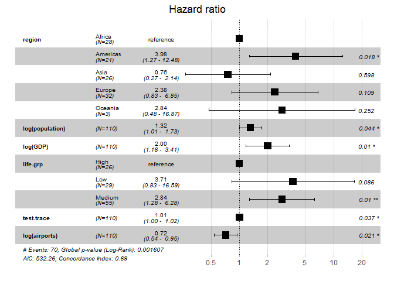<!-- -->

### 3.2.3 Stepwise

After having a model by choosing variable manually, we can use step
function to automatically find a model that give the best AIC. We can
see that the step model is the same as our reduced model.

``` r
step.mod <-
  step(
    full.mod,
    scope = list(
      upper =  ~ region + log(population)  +
        life.grp + log(GDP) + gini + unemployment +
        median_age + test + trace + test.trace + road + log(airports),
      lower =  ~ region
    ),
    trace = F
  )

step.mod
```

    ## Call:
    ## coxph(formula = surv.obj ~ region + log(population) + life.grp + 
    ##     log(GDP) + test.trace + log(airports), data = data)
    ## 
    ##                      coef exp(coef)  se(coef)      z       p
    ## regionAmericas   1.380978  3.978790  0.583152  2.368 0.01788
    ## regionAsia      -0.280642  0.755299  0.531877 -0.528 0.59775
    ## regionEurope     0.866320  2.378144  0.539836  1.605 0.10854
    ## regionOceania    1.042787  2.837114  0.909701  1.146 0.25167
    ## log(population)  0.277754  1.320161  0.137890  2.014 0.04398
    ## life.grpLow      1.312353  3.714905  0.763491  1.719 0.08564
    ## life.grpMedium   1.044216  2.841169  0.405012  2.578 0.00993
    ## log(GDP)         0.695530  2.004770  0.270734  2.569 0.01020
    ## test.trace       0.010198  1.010250  0.004892  2.085 0.03711
    ## log(airports)   -0.331641  0.717745  0.143560 -2.310 0.02088
    ## 
    ## Likelihood ratio test=28.32  on 10 df, p=0.001607
    ## n= 110, number of events= 70

Model from step function agree with our choice.

### 3.3.4 Final Model

Since the reduce model and step model are the same, we confident that we
found the best model for our data. Table below shows the output of the
final model.

``` r
final.mod <- step.mod
summary(final.mod)
```

    ## Call:
    ## coxph(formula = surv.obj ~ region + log(population) + life.grp + 
    ##     log(GDP) + test.trace + log(airports), data = data)
    ## 
    ##   n= 110, number of events= 70 
    ## 
    ##                      coef exp(coef)  se(coef)      z Pr(>|z|)   
    ## regionAmericas   1.380978  3.978790  0.583152  2.368  0.01788 * 
    ## regionAsia      -0.280642  0.755299  0.531877 -0.528  0.59775   
    ## regionEurope     0.866320  2.378144  0.539836  1.605  0.10854   
    ## regionOceania    1.042787  2.837114  0.909701  1.146  0.25167   
    ## log(population)  0.277754  1.320161  0.137890  2.014  0.04398 * 
    ## life.grpLow      1.312353  3.714905  0.763491  1.719  0.08564 . 
    ## life.grpMedium   1.044216  2.841169  0.405012  2.578  0.00993 **
    ## log(GDP)         0.695530  2.004770  0.270734  2.569  0.01020 * 
    ## test.trace       0.010198  1.010250  0.004892  2.085  0.03711 * 
    ## log(airports)   -0.331641  0.717745  0.143560 -2.310  0.02088 * 
    ## ---
    ## Signif. codes:  0 '***' 0.001 '**' 0.01 '*' 0.05 '.' 0.1 ' ' 1
    ## 
    ##                 exp(coef) exp(-coef) lower .95 upper .95
    ## regionAmericas     3.9788     0.2513    1.2687    12.478
    ## regionAsia         0.7553     1.3240    0.2663     2.142
    ## regionEurope       2.3781     0.4205    0.8255     6.851
    ## regionOceania      2.8371     0.3525    0.4770    16.874
    ## log(population)    1.3202     0.7575    1.0075     1.730
    ## life.grpLow        3.7149     0.2692    0.8319    16.589
    ## life.grpMedium     2.8412     0.3520    1.2845     6.284
    ## log(GDP)           2.0048     0.4988    1.1793     3.408
    ## test.trace         1.0102     0.9899    1.0006     1.020
    ## log(airports)      0.7177     1.3933    0.5417     0.951
    ## 
    ## Concordance= 0.693  (se = 0.038 )
    ## Likelihood ratio test= 28.32  on 10 df,   p=0.002
    ## Wald test            = 28.38  on 10 df,   p=0.002
    ## Score (logrank) test = 30.25  on 10 df,   p=8e-04

# 4\. Model Diagnostic

In this section, we will undertake model diagnostics to check the model
assumptions and other modeling issues. We access the validity of our
model by + (1) using Schoenfeld residuals for each covariate, vs Time or
log(Time) to check proportional hazards assumption, + (2) plotting
deviance residuals vs Observation number to check for outliers, + (3)
plotting martingale residuals vs continuous covariates to check their
functional form and ensure linearity assumption is not violated.

## 4.1 Proportional hazards assumption

The Schoenfeld residuals should be independent of time. The test is not
statistically significant which indicate the assunption is valid.

``` r
(test <- cox.zph(final.mod))
```

    ##                  chisq df    p
    ## region          2.8187  4 0.59
    ## log(population) 1.2938  1 0.26
    ## life.grp        1.6973  2 0.43
    ## log(GDP)        2.1900  1 0.14
    ## test.trace      0.0835  1 0.77
    ## log(airports)   1.3543  1 0.24
    ## GLOBAL          7.4654 10 0.68

We can also graph the scaled Schoenfeld residuals against the
transformed time for each covariate.Validity of the assumption is shown
by the absence of pattern of Schoenfeld residuals over time, and points
centered at zero line. Since no pattern is observed from any of the
above plots, the proportional hazard assumption holds.

``` r
ggcoxzph(test,);
```

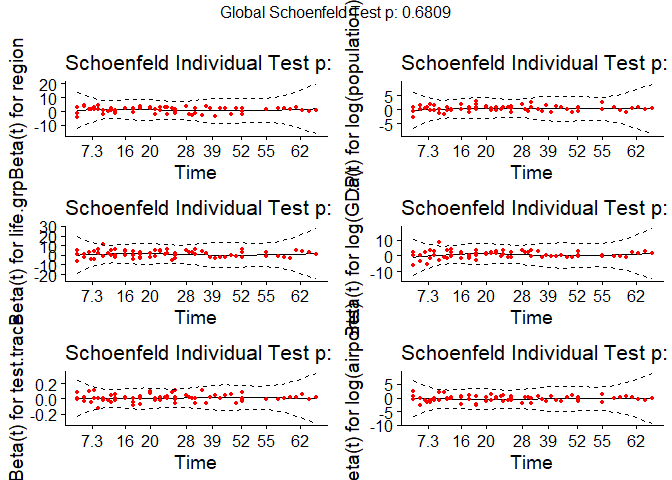<!-- -->

## 4.2 Influential obs

Next, we visualize the deviance residuals and the dfbeta values.

Since the sample size for this project is relatively small, only dfbetas
residuals with absolute values over 1 will be considered significant. In
the plots above, although some points have larger values than others but
still much less than 1. Thus, no influential observation exists.

``` r
ggcoxdiagnostics(final.mod, type = "dfbeta", linear.predictions = F)
```

    ## `geom_smooth()` using formula 'y ~ x'

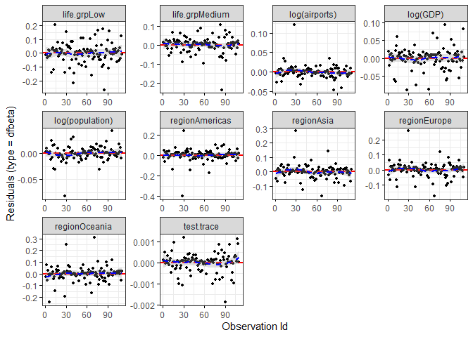<!-- -->

## 4.3 Outlier

All deviances are bounded within –2.5 and +3, and no pattern is
observed. Thus, it is fair to conclude that there is no outlier in the
final model.

``` r
ggcoxdiagnostics(
  final.mod,
  type = "deviance",
  linear.predictions = FALSE,
  ggtheme = theme_bw()
)
```

    ## `geom_smooth()` using formula 'y ~ x'

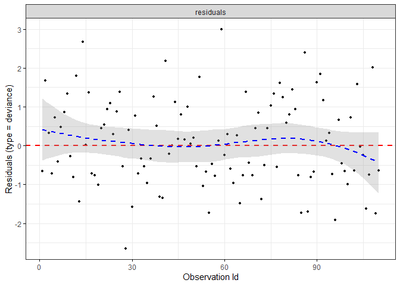<!-- -->

## 4.4 Linear test

To check linearity, Martingale residual is plotted against different
variables. Nonlinearity is not an issue for categorical variables, so
Martingale residual is only plotted against continuous covariates in the
final model. LOWESS lines of residuals are expected to be flat to
satisfy the linear assumption. When the result is not satisfying, log
transformation is used to rescale the variable. In the end, there is no
clear violation of the assumption.

``` r
coxph.null <- coxph(surv.obj ~ 1, data = data)
resid.m.null <- residuals(coxph.null, type = "martingale")

par(mfrow = c(2, 2))

plot(resid.m.null ~ log(GDP), data, ylab = "Martingale Residual")
loessline(resid.m.null, log(data$GDP))

plot(resid.m.null ~ log(population), data, ylab = "Martingale Residual")
loessline(resid.m.null, log(data$population))

plot(resid.m.null ~ test.trace, data, ylab = "Martingale Residual")
loessline(resid.m.null, data$test.trace)

plot(resid.m.null ~ log(airports), data, ylab = "Martingale Residual")
loessline(resid.m.null, log(data$airports))
```

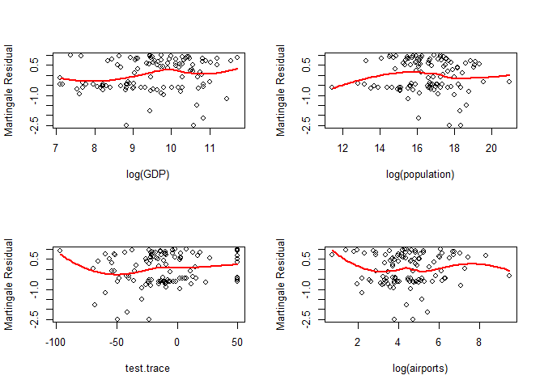<!-- -->

# 5\. Model Inference

``` r
summary(final.mod)
```

    ## Call:
    ## coxph(formula = surv.obj ~ region + log(population) + life.grp + 
    ##     log(GDP) + test.trace + log(airports), data = data)
    ## 
    ##   n= 110, number of events= 70 
    ## 
    ##                      coef exp(coef)  se(coef)      z Pr(>|z|)   
    ## regionAmericas   1.380978  3.978790  0.583152  2.368  0.01788 * 
    ## regionAsia      -0.280642  0.755299  0.531877 -0.528  0.59775   
    ## regionEurope     0.866320  2.378144  0.539836  1.605  0.10854   
    ## regionOceania    1.042787  2.837114  0.909701  1.146  0.25167   
    ## log(population)  0.277754  1.320161  0.137890  2.014  0.04398 * 
    ## life.grpLow      1.312353  3.714905  0.763491  1.719  0.08564 . 
    ## life.grpMedium   1.044216  2.841169  0.405012  2.578  0.00993 **
    ## log(GDP)         0.695530  2.004770  0.270734  2.569  0.01020 * 
    ## test.trace       0.010198  1.010250  0.004892  2.085  0.03711 * 
    ## log(airports)   -0.331641  0.717745  0.143560 -2.310  0.02088 * 
    ## ---
    ## Signif. codes:  0 '***' 0.001 '**' 0.01 '*' 0.05 '.' 0.1 ' ' 1
    ## 
    ##                 exp(coef) exp(-coef) lower .95 upper .95
    ## regionAmericas     3.9788     0.2513    1.2687    12.478
    ## regionAsia         0.7553     1.3240    0.2663     2.142
    ## regionEurope       2.3781     0.4205    0.8255     6.851
    ## regionOceania      2.8371     0.3525    0.4770    16.874
    ## log(population)    1.3202     0.7575    1.0075     1.730
    ## life.grpLow        3.7149     0.2692    0.8319    16.589
    ## life.grpMedium     2.8412     0.3520    1.2845     6.284
    ## log(GDP)           2.0048     0.4988    1.1793     3.408
    ## test.trace         1.0102     0.9899    1.0006     1.020
    ## log(airports)      0.7177     1.3933    0.5417     0.951
    ## 
    ## Concordance= 0.693  (se = 0.038 )
    ## Likelihood ratio test= 28.32  on 10 df,   p=0.002
    ## Wald test            = 28.38  on 10 df,   p=0.002
    ## Score (logrank) test = 30.25  on 10 df,   p=8e-04

Based on the final model, countries in Americas is significant and has
nearly 4 times the HR, exp(coef)=3.9787, of countries in Africa.
Americas countries tend to lockdown fast. If log(population) increases
by 1 then the HR increase by 32%. It means that countries with large
population lock down early. One possible explanation is the risk of
COVID spreading is faster in high population, so countries need to act
faster.

Medium life.grp is significant and has exp(coef) of 2.8411 which
indicates that countries with medium life expectancy has 2.8 times HR
compare to high life expectancy. If we assume life expectancy as proxy
for health services, then countries have worse health services lockdown
earlier. A 1-point increase in log(GDP) increase HR by (2.0047 - 1) =
100%.

Countries with small number of Airports has higher HR which indicates a
country will lockdown early if it has small air travel capacity. Hence,
small, and isolated counties are more likely to lock down early. Test
trace is significant, but the effect is small, it only increases HR by
1%.
