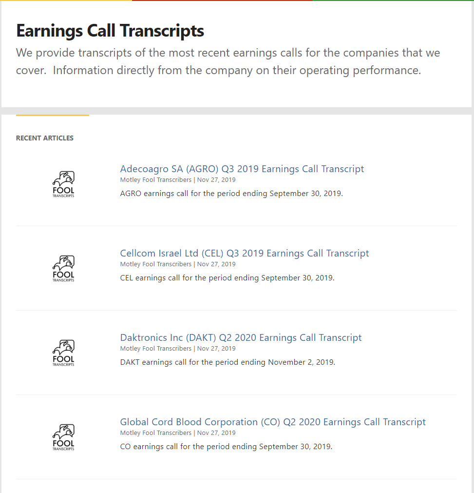
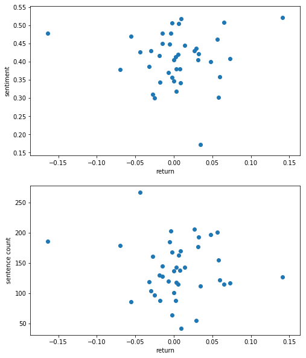
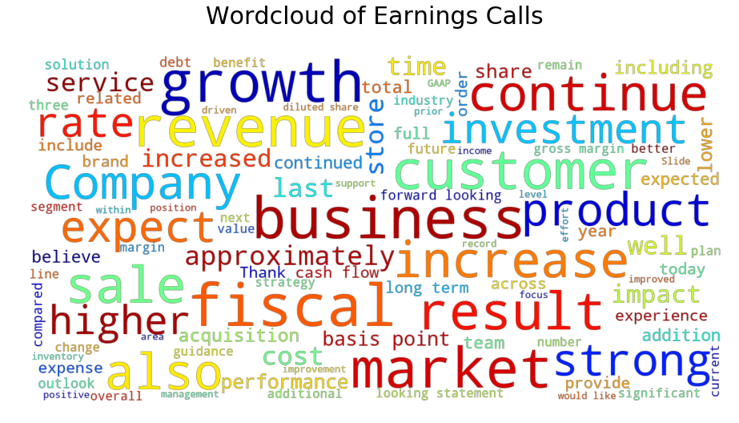

# Overview

This project focuses on the data mining and cleaning processes on earnings conference call transcripts, with a little bit of Exploratory data analysis (EDA) at the end.
In this project, we will perform following tasks:
+ Use Beautifulsoup to parse html
+ Split transcripts into several sections: Manager presentation, Q&A
+ Separate text by speaker
+ Calculate word count, sentence count, and sentiment using NLTK
+ Retrieve firm stock price return on the day of the earnings call
+ EDA

This is for educational purposes only, please scrape responsibly.
{: .notice--danger}

Install the required libraries


```python
import requests
import urllib.request
from bs4 import BeautifulSoup
import unicodedata
import pandas as pd
import numpy as np
```

# Data Mining

**Set up hyperparameters**


```python
user_agent = 'Mozilla/5.0 (Macintosh; Intel Mac OS X 10_9_3) AppleWebKit/537.36 (KHTML, like Gecko) Chrome/35.0.1916.47 Safari/537.36'
headers = {'User-Agent': user_agent}
base = 'https://www.fool.com'
data = pd.DataFrame()
```

**Accessing the HTML content from webpage**

The urls to conference call transcripts are located on https://www.fool.com/earnings-call-transcripts/?page={i} with i is the page number. Each page contains urls to 20 transcripts.



If we right click on a tiltl(i.e.) and click Inspect, we see where the link for each transcript are.

```HTML
<a href="/earnings/call-transcripts/2019/11/27/cellcom-israel-ltd-cel-q3-2019-earnings-call-trans.aspx"
  data-id="article-list-hl">
  Cellcom Israel Ltd (CEL) Q3 2019 Earnings Call Transcript</a>
```

We loop through pages to get transcripts url. We can specify what page to start  (*start_pg*) and how many pages we want to look at (*num_pg*).

For each page, we use **requests.get()** to request the server the content then use **Beautifulsoup** to parse the HTML content. We then use **find_all()** to find all an anchor tag ('a') that have 'data-id' attribute of 'article-list-hl' which contain the urls we need. Lastly, we add the results from **find_all** into a list (*links*).


```python
links = []

start_pg = 128
num_pg = 2

for i in range(start_pg,start_pg+num_pg):
    url = f"https://www.fool.com/earnings-call-transcripts/?page={i}"
    response = requests.get(url,headers=headers)
    soup = BeautifulSoup(response.text, 'html.parser')
    links += soup.find_all('a', {'data-id' : 'article-list-hl'})
```

Next, we look at each item in the list. Since it's still in html format, we extract *href* and *text* sections of the html and add those to a dataframe.


```python
for l in links:
    data = data.append({'url':base+l['href'],
                    'desc':l.text,'html':"Missing"},
                    ignore_index=True)
```

Our data looks as follows. The *html* column is for the html from transcripts' url.


```python
data.head()
```


<div>
<style scoped>
    .dataframe tbody tr th:only-of-type {
        vertical-align: middle;
    }

    .dataframe tbody tr th {
        vertical-align: top;
    }

    .dataframe thead th {
        text-align: right;
    }
</style>
<table border="1" class="dataframe">
  <thead>
    <tr style="text-align: right;">
      <th></th>
      <th>desc</th>
      <th>html</th>
      <th>url</th>
    </tr>
  </thead>
  <tbody>
    <tr>
      <th>0</th>
      <td>Adecoagro SA (AGRO) Q3 2019 Earnings Call Tran...</td>
      <td>Missing</td>
      <td>https://www.fool.com/earnings/call-transcripts...</td>
    </tr>
    <tr>
      <th>1</th>
      <td>Cellcom Israel Ltd (CEL) Q3 2019 Earnings Call...</td>
      <td>Missing</td>
      <td>https://www.fool.com/earnings/call-transcripts...</td>
    </tr>
    <tr>
      <th>2</th>
      <td>Daktronics Inc (DAKT) Q2 2020 Earnings Call Tr...</td>
      <td>Missing</td>
      <td>https://www.fool.com/earnings/call-transcripts...</td>
    </tr>
    <tr>
      <th>3</th>
      <td>Global Cord Blood Corporation (CO) Q2 2020 Ear...</td>
      <td>Missing</td>
      <td>https://www.fool.com/earnings/call-transcripts...</td>
    </tr>
    <tr>
      <th>4</th>
      <td>Frontline Ltd (FRO) Q3 2019 Earnings Call Tran...</td>
      <td>Missing</td>
      <td>https://www.fool.com/earnings/call-transcripts...</td>
    </tr>
  </tbody>
</table>
</div>


Now, we can move on to retreiving html for transcripts. We loop through rows in our dataframe, get link to transcript from url columns, retrieve content in html format, look for *span* tag with *class* atribute of *'article-content'*, and lastly add it to html column.

We can filter out rows that already have the html data and only work on the missing ones.

I add sample(1) to avoid denided by server.


```python
data_missing = data[(data['html']=="Missing")]
for index, row in data_missing.iterrows():       
    url = row['url']
    print(f"Retrieving {url}")
    response = requests.get(url)
    soup = BeautifulSoup(response.content, 'html.parser')
    data.at[index, 'html'] = soup.find('span', {'class' : 'article-content'})
print('Finished downloading transcripts in html format')
```

    Retrieving https://www.fool.com/earnings/call-transcripts/2019/11/27/adecoagro-sa-agro-q3-2019-earnings-call-transcript.aspx
    Retrieving https://www.fool.com/earnings/call-transcripts/2019/11/27/cellcom-israel-ltd-cel-q3-2019-earnings-call-trans.aspx
    Retrieving https://www.fool.com/earnings/call-transcripts/2019/11/27/daktronics-inc-dakt-q2-2020-earnings-call-transcri.aspx
    ...
    Retrieving https://www.fool.com/earnings/call-transcripts/2019/11/26/hormel-foods-corp-hrl-q4-2019-earnings-call-transc.aspx
    Retrieving https://www.fool.com/earnings/call-transcripts/2019/11/26/dycom-industries-inc-dy-q3-2020-earnings-call-tran.aspx
    Retrieving https://www.fool.com/earnings/call-transcripts/2019/11/26/elbit-systems-ltd-eslt-q3-2019-earnings-call-trans.aspx
    Retrieving https://www.fool.com/earnings/call-transcripts/2019/11/26/bitauto-holdings-limited-bita-q3-2019-earnings-cal.aspx
    Finished downloading transcripts in html format


Let's look at the data with html contents


```python
df = data[(data['html']!="Missing")].copy().reset_index(drop=True)
df.head()
```


<div>
<style scoped>
    .dataframe tbody tr th:only-of-type {
        vertical-align: middle;
    }

    .dataframe tbody tr th {
        vertical-align: top;
    }

    .dataframe thead th {
        text-align: right;
    }
</style>
<table border="1" class="dataframe">
  <thead>
    <tr style="text-align: right;">
      <th></th>
      <th>desc</th>
      <th>html</th>
      <th>url</th>
    </tr>
  </thead>
  <tbody>
    <tr>
      <th>0</th>
      <td>Adecoagro SA (AGRO) Q3 2019 Earnings Call Tran...</td>
      <td>[\n, [[\n, &lt;p class="caption"&gt;Image source: Th...</td>
      <td>https://www.fool.com/earnings/call-transcripts...</td>
    </tr>
    <tr>
      <th>1</th>
      <td>Cellcom Israel Ltd (CEL) Q3 2019 Earnings Call...</td>
      <td>[\n, [[\n, &lt;p class="caption"&gt;Image source: Th...</td>
      <td>https://www.fool.com/earnings/call-transcripts...</td>
    </tr>
    <tr>
      <th>2</th>
      <td>Daktronics Inc (DAKT) Q2 2020 Earnings Call Tr...</td>
      <td>[\n, [[\n, &lt;p class="caption"&gt;Image source: Th...</td>
      <td>https://www.fool.com/earnings/call-transcripts...</td>
    </tr>
    <tr>
      <th>3</th>
      <td>Global Cord Blood Corporation (CO) Q2 2020 Ear...</td>
      <td>[\n, [[\n, &lt;p class="caption"&gt;Image source: Th...</td>
      <td>https://www.fool.com/earnings/call-transcripts...</td>
    </tr>
    <tr>
      <th>4</th>
      <td>Frontline Ltd (FRO) Q3 2019 Earnings Call Tran...</td>
      <td>[\n, [[\n, &lt;p class="caption"&gt;Image source: Th...</td>
      <td>https://www.fool.com/earnings/call-transcripts...</td>
    </tr>
  </tbody>
</table>
</div>


Here is the html content of a transcript. The result is truncated. 


```python
df['html'][0]
```


    <span class="article-content">
    <div class="image imgR">
    <p class="caption">Image source: The Motley Fool.</p>
    </img></div>
    <p><strong>Adecoagro SA</strong>  <span class="ticker" data-id="224958">(<a href="https://www.fool.com/quote/nyse/adecoagro/agro/">NYSE:AGRO</a>)</span><br>Q3 2019 Earnings Call<br/><span id="date">Nov. 14, 2019</span>, <em id="time">9:00 a.m. ET</em></br></p>
    <h2>Contents:</h2>
    <ul>
    <li>Prepared Remarks</li>
    <li>Questions and Answers</li>
    <li>Call Participants</li>
    </ul>
    <h2>Prepared Remarks:</h2>
    <p><strong>Operator</strong></p>
    <p>Good morning, ladies and gentlemen, and thank you for waiting. At this time, we would like to welcome everyone to Adecoagro's Third Quarter 2019 Results Conference Call. Today with us, we have Mr. Mariano Bosch, CEO; Mr. Charlie Boero Hughes, CFO; and Mr. Juan Ignacio Galleano, Investor Relations-Manager. We would like to inform you that this event is being recorded and all participants will be in a listen-only mode. [Operator Instructions]</p>
    <p>Before proceeding, let me mention the forward-looking statements are based on beliefs and assumptions of Adecoagro's management and on information currently available to the company. They involve risks, uncertainties and assumptions because they relate to future events and therefore depend on circumstances that may or may not occur in the future. Investors should understand that general economic conditions, industry conditions and other operating factors could also affect the results of Adecoagro and could cause results to differ materially from those expressed in such forward-looking statements.</p>
    <p>Now I'll turn the conference over to Mr. Mariano Bosch, CEO. Mr. Bosch, you may begin your conference.</p>
    <p><strong>Mariano Bosch</strong> -- <em>Co-Founder, Chief Executive Officer and Director</em></p>
    <p>Good morning, and thank you for joining Adecoagro's 2019 third quarter results conference. In our Sugar, Ethanol and Energy business, as already discussed in previous releases, we experienced dry weather in Mato Grosso do Sul with registered rains way below average. Needless to say, this has affected yields and future cane development. The impact though has been mitigated by lowering crushing per hour with the purpose of maximizing ethanol production and allow the cane to continue growth.</p>
    <p>Year-to-date, we were able to divert 83% of our total produced TRS into ethanol. This has allowed us to make a much more efficient use of our sugarcane. Actually, hydrous and anhydrous ethanol traded at 17% and 20% premium to sugar during the year. I would like to stress that the increase in ethanol mix was not only driven by lower crushing per hour. Thanks to our industrial and operational enhancements, at the industry level, we were able to genuinely increase our ethanol daily production by 500 cubic meters. This explains why ethanol accounted for 74% of total sugar, ethanol and energy EBITDA.</p>
    <p>It's important to highlight that we were able to fully profit from our ethanol maximization strategy as we built four additional storage ethanol tanks, adding 80,000 cubic meters of storage capacity. Factoring for the price differential between ethanol in June, July vis-a-vis today's prices, the investments has already been more than paid within a year.</p>
    <p>Regarding our five-year plan, we continue on schedule with the most important part that is a sugarcane planting. Dry weather has certainly delayed our crushing plan for 2019 and the beginning of 2020. We have rains now, and weather appears to be normalizing. This is why we feel confident that as of the second quarter of 2020, we will be able to resume crushing activities according to the original plan.</p>
    <p>Moving to our Farming business, political and economic uncertainties in Argentina posed operational challenges. Specifically, after the primary left [Phonetic] over, market sentiment shifted abruptly and relative prices adjusted accordingly. In this line, our latest farmland independent appraisal reflects a 10% reduction year-over-year for our farmland in Argentina. The value for our Brazilian and US dollars [Phonetic] in farmland, however, remained unchanged. As of today, we are in the middle of the planting season, weather by conditions are optimum. All of our operational teams at the fields are fully focused and aligned. We feel confident to face economic uncertainties ahead. Thanks to the attained efficiencies and to the flexibility we have in all of our businesses to divert sales to the domestic or export market, maximizing margins.</p>
    ......
    <p>Our next question is a follow-up from Fernanda Cunha of Citibank. Please go ahead.</p>
    <p><strong>Fernanda Cunha</strong> -- <em>Citibank -- Analyst</em></p>
    <p>Hi, thank you for taking my questions. Now, I just wanted if you could give some updates on the RenovaBio program? Also, if you are now that some of your mills, I guess, have been have received the certificate, can we still work with the carbon credit sale cost reduction of around $55 [Phonetic] per cubic meter? Or has that changed?</p>
    <p><strong>Mariano Bosch</strong> -- <em>Co-Founder, Chief Executive Officer and Director</em></p>
    <p>Renato?</p>
    <p><strong>Renato Junqueira-Santos Pereira</strong> -- <em>Director of the Sugar, Ethanol and Energy Department.</em></p>
    <p>It's easy to project the amount of CBU that will be selling we're going to be selling approximately 1.5% of CBU per cubic meter. The price of CBU is still unknown. I think the projects that we have been using is around $10 CBU.</p>
    <p><strong>Fernanda Cunha</strong> -- <em>Citibank -- Analyst</em></p>
    <p>Okay, thank you.</p>
    <p><strong>Operator</strong></p>
    <p>This concludes the question-and-answer section. At this time, I would like to turn the floor back to Mr. Bosch for any closing remarks. Please go ahead, sir.</p>
    <p><strong>Mariano Bosch</strong> -- <em>Co-Founder, Chief Executive Officer and Director</em></p>
    <p>Before closing the last earning call of the earnings call of the year, I would like to thank you all for your support and confidence and let you know that we have renewed our commitment to continue with our obsession to create shareholder value. We have a promising 2020 coming ahead and are ready to accept the challenges. So hope seeing you during our next IR event.</p>
    <p><strong>Operator</strong></p>
    <p>[Operator Closing Remarks]</p>
    <p><strong>Duration: 42 minutes</strong></p>
    <h2>Call participants:</h2>
    <p><strong>Mariano Bosch</strong> -- <em>Co-Founder, Chief Executive Officer and Director</em></p>
    <p><strong>Carlos A. Boero Hughes</strong> -- <em>Chief Financial Officer</em></p>
    <p><strong>Thiago Duarte</strong> -- <em>BTG Pactual -- Analyst</em></p>
    <p><strong>Renato Junqueira-Santos Pereira</strong> -- <em>Director of the Sugar, Ethanol and Energy Department.</em></p>
    <p><strong>Fernanda Cunha</strong> -- <em>Citibank -- Analyst</em></p>
    <p><strong>Lucas Ferreira</strong> -- <em>JPMorgan -- Analyst</em></p>
    <p><a href="https://www.fool.com/quote/agro">More AGRO analysis</a></p>
    <p>Transcript powered by <a href="https://www.alphastreet.com" target="\_blank">AlphaStreet</a></p>
    <p><em>This article is a transcript of this conference call produced for The Motley Fool. While we strive for our Foolish Best, there may be errors, omissions, or inaccuracies in this transcript. As with all our articles, The Motley Fool does not assume any responsibility for your use of this content, and we strongly encourage you to do your own research, including listening to the call yourself and reading the company's SEC filings. Please see our </em><a href="https://www.fool.com/legal/terms-and-conditions/fool-rules"><em>Terms and Conditions</em></a><em> for additional details, including our Obligatory Capitalized Disclaimers of Liability.</em></p>
    <p></p><div id="pitch"></div>
    </span>


# Data Cleaning

Now we have relevant data in html format. We need to convert them into text.

## Get firm information

First, let's get the company name, stock symbol, and report period for each the transcript. We create a function **get_desc** to look at the text then split it by specific strings.


```python
def get_desc(text):
    """ Extract firm name, ticker and earnings quarter
    from link's description
    """
    firm_name, txt_left = text.split(' (',1)
    ticker, txt_left = txt_left.split(') ',1)
    year_quarter = txt_left.split(' Earnings')[0]
    return firm_name, ticker, year_quarter
```

We use **apply** function in **pandas** to use **get_desc** for each row in a column. We will extract the transcript information from *desc* column.


```python
df['desc'].apply(get_desc)[:10]
```


    0                   (Adecoagro SA, AGRO, Q3 2019)
    1              (Cellcom Israel Ltd, CEL, Q3 2019)
    2                 (Daktronics Inc, DAKT, Q2 2020)
    3    (Global Cord Blood Corporation, CO, Q2 2020)
    4                   (Frontline Ltd, FRO, Q3 2019)
    5                   (Uxin Limited, UXIN, Q3 2019)
    6        (Central Garden & Pet Co, CENT, Q4 2019)
    7          (Arco Platform Limited, ARCE, Q3 2019)
    8       (Dick's Sporting Goods Inc, DKS, Q3 2019)
    9              (Veeva Systems Inc, VEEV, Q3 2020)
    Name: desc, dtype: object


## Split up transcript
Next, we need to separate transcripts into different parts. The conference calls have 2 sections, Management Presentation where managers talk about the firm performance and Question and Answer section where managers answer question from analysts.

Since the sections header are in `<h2>` tags. We can use **find_all** to return a list of all `<p>` and `<h2>` tags and then note the location of `<h2>` tag in the list. Lastly, we split the list using those indexes.


```python
def split_sections(html):
    # Find tags
    if type(html) == str:    
        soup = BeautifulSoup(html, 'html.parser')
        content = soup.find_all(['p','h2'])
    else:
        content = html.find_all(['p','h2'])

    # Add location of above tags to a list
    split_idx = []
    for idx, elem in enumerate(content):
        if elem.name == 'h2':
            split_idx.append(idx)

    # Use split_idx to split the list
    sections = [content[i : j] for i, j in zip([0] + split_idx, split_idx + [None])]
    title = sections[0][1].text
    presn = sections[2]
    qa = sections[3]
    participants = sections[4]

    return title, presn, qa, participants
```

Let's test the function using the first record in our data. Since the function returns a list of 4 values, we will look at those seperately.


```python
transcript_html = df['html'][0]
sections = split_sections(transcript_html)
# Title
sections[0]
```


    'Adecoagro SA\xa0 (NYSE:AGRO)Q3\xa02019 Earnings CallNov. 14, 2019, 9:00 a.m. ET'


```python
# Managers Presenation section
sections[1][:5]
```


    [<h2>Prepared Remarks:</h2>,
     <p><strong>Operator</strong></p>,
     <p>Good morning, ladies and gentlemen, and thank you for waiting. At this time, we would like to welcome everyone to Adecoagro's Third Quarter 2019 Results Conference Call. Today with us, we have Mr. Mariano Bosch, CEO; Mr. Charlie Boero Hughes, CFO; and Mr. Juan Ignacio Galleano, Investor Relations-Manager. We would like to inform you that this event is being recorded and all participants will be in a listen-only mode. [Operator Instructions]</p>,
     <p>Before proceeding, let me mention the forward-looking statements are based on beliefs and assumptions of Adecoagro's management and on information currently available to the company. They involve risks, uncertainties and assumptions because they relate to future events and therefore depend on circumstances that may or may not occur in the future. Investors should understand that general economic conditions, industry conditions and other operating factors could also affect the results of Adecoagro and could cause results to differ materially from those expressed in such forward-looking statements.</p>]


```python
# Q&A section
sections[2][:5]
```


    [<h2>Questions and Answers:</h2>,
     <p><strong>Operator</strong></p>,
     <p>Thank you. [Operator Instructions] And our first question will come from Thiago Duarte of BTG. Please go ahead, sir.</p>,
     <p><strong>Thiago Duarte</strong> -- <em>BTG Pactual -- Analyst</em></p>,
     <p>Thank you so much. Good morning, Mariano. Good morning, Charlie. I have two questions. The first one is on the sugarcane crushing volumes. I appreciate the comments on the drought and the intentions to reduce the crushing activity over the next two quarters and hopefully normalize them by the second quarter of next year. So I was just wondering in terms of total crushing for 2020, how much do you expect the drought as well as the frost, that affected the region in Mato Grosso do Sul to impact your capacity to crush at full speed next year, even considering, of course, that rainfalls have sort of improved recently? And in the end of the day, how much you expect in terms of the net effect for the crushing volumes next year?</p>]


```python
# Participants
sections[3]
```


    [<h2>Call participants:</h2>,
     <p><strong>Mariano Bosch</strong> -- <em>Co-Founder, Chief Executive Officer and Director</em></p>,
     <p><strong>Carlos A. Boero Hughes</strong> -- <em>Chief Financial Officer</em></p>,
     <p><strong>Thiago Duarte</strong> -- <em>BTG Pactual -- Analyst</em></p>,
     <p><strong>Renato Junqueira-Santos Pereira</strong> -- <em>Director of the Sugar, Ethanol and Energy Department.</em></p>,
     <p><strong>Fernanda Cunha</strong> -- <em>Citibank -- Analyst</em></p>,
     <p><strong>Lucas Ferreira</strong> -- <em>JPMorgan -- Analyst</em></p>,
     <p><a href="https://www.fool.com/quote/agro">More AGRO analysis</a></p>,
     <p>Transcript powered by <a href="https://www.alphastreet.com" target="\_blank">AlphaStreet</a></p>,
     <p><em>This article is a transcript of this conference call produced for The Motley Fool. While we strive for our Foolish Best, there may be errors, omissions, or inaccuracies in this transcript. As with all our articles, The Motley Fool does not assume any responsibility for your use of this content, and we strongly encourage you to do your own research, including listening to the call yourself and reading the company's SEC filings. Please see our </em><a href="https://www.fool.com/legal/terms-and-conditions/fool-rules"><em>Terms and Conditions</em></a><em> for additional details, including our Obligatory Capitalized Disclaimers of Liability.</em></p>,
     <p></p>]


## Separate by speaker

To separate a transcript by speaker, we create a function that similar to **split_section**. We look for items with `<strong>` tag and use their location to split.


```python
def seperate_speaker(section):
    split_idx = []
    for idx, elem in enumerate(section):
        if elem.strong:
            #print(elem)
            split_idx.append(idx)
    result = [section[i : j] for i, j in zip([0] + split_idx, split_idx + [None])]
    return result
```

After splitting a transcript by speaker, we create a function **get_speaker_info** to get speakers' information and content of their speech.

Since `<strong>` tag contain speaker's name, job title and firm, we can separate them by spliting using *'--'*. However, if a speaker is from the presenting firm, then the firm name is omitted. Hence, we need to account for that using **if, else** statement.
Lastly, the function returns a dataframe.


```python
def get_speaker_info(section, label):
    df = pd.DataFrame()
    for elem in seperate_speaker(section):
        speaker_name = speaker_firm = speaker_position = ""
        if len(elem) > 1:
            speaker_text = " ".join(map(lambda x: x.text, elem[1:]))
            speaker_info= elem[0].text.split('--')
            if len(speaker_info) == 3:
                speaker_name  = speaker_info[0]
                speaker_firm  = speaker_info[1]
                speaker_position  = speaker_info[2]
            elif len(speaker_info) == 2:
                speaker_name  = speaker_info[0]
                speaker_firm  = "Presenting Firm"
                speaker_position = speaker_info[1]
            else:
                speaker_name = speaker_info[0]

            df = df.append({'Name': speaker_name, 'Position':speaker_position,
                            'Company':speaker_firm, 'Text': speaker_text, 'Section':label}, ignore_index=True)
    df = df[df['Name']!='Operator'].reset_index(drop=True)
    df = df.groupby(['Name','Section'], as_index = False).agg({'Text': ' '.join, 'Position':'first','Company':'first'})
    return df
```

Use **get_speaker_info** function on the presentation and the Q&A sections to further split them up.


```python
presn = sections[1]
qa = sections[2]
qa_by_speaker = get_speaker_info(qa, 'Question and Answer')
presn_by_speaker = get_speaker_info(presn, 'Presentation')

transcript_by_speaker = pd.concat([presn_by_speaker,qa_by_speaker])
transcript_by_speaker
```


<div>
<style scoped>
    .dataframe tbody tr th:only-of-type {
        vertical-align: middle;
    }

    .dataframe tbody tr th {
        vertical-align: top;
    }

    .dataframe thead th {
        text-align: right;
    }
</style>
<table border="1" class="dataframe">
  <thead>
    <tr style="text-align: right;">
      <th></th>
      <th>Name</th>
      <th>Section</th>
      <th>Text</th>
      <th>Position</th>
      <th>Company</th>
    </tr>
  </thead>
  <tbody>
    <tr>
      <th>0</th>
      <td>Carlos A. Boero Hughes</td>
      <td>Presentation</td>
      <td>Thank you, Mariano. Good morning, everyone. Le...</td>
      <td>Chief Financial Officer</td>
      <td>Presenting Firm</td>
    </tr>
    <tr>
      <th>1</th>
      <td>Mariano Bosch</td>
      <td>Presentation</td>
      <td>Good morning, and thank you for joining Adecoa...</td>
      <td>Co-Founder, Chief Executive Officer and Director</td>
      <td>Presenting Firm</td>
    </tr>
    <tr>
      <th>0</th>
      <td>Fernanda Cunha</td>
      <td>Question and Answer</td>
      <td>Hi, good morning everyone. Thank you for takin...</td>
      <td>Analyst</td>
      <td>Citibank</td>
    </tr>
    <tr>
      <th>1</th>
      <td>Lucas Ferreira</td>
      <td>Question and Answer</td>
      <td>Hi, good morning everyone. So my first questio...</td>
      <td>Analyst</td>
      <td>JPMorgan</td>
    </tr>
    <tr>
      <th>2</th>
      <td>Mariano Bosch</td>
      <td>Question and Answer</td>
      <td>Hi, Thiago. Thank you for your question. I'm g...</td>
      <td>Co-Founder, Chief Executive Officer and Director</td>
      <td>Presenting Firm</td>
    </tr>
    <tr>
      <th>3</th>
      <td>Renato Junqueira-Santos Pereira</td>
      <td>Question and Answer</td>
      <td>Hi Thiago, thank you for your question. It was...</td>
      <td>Director of the Sugar, Ethanol and Energy Dep...</td>
      <td>Presenting Firm</td>
    </tr>
    <tr>
      <th>4</th>
      <td>Thiago Duarte</td>
      <td>Question and Answer</td>
      <td>Thank you so much. Good morning, Mariano. Good...</td>
      <td>Analyst</td>
      <td>BTG Pactual</td>
    </tr>
  </tbody>
</table>
</div>


## Natural Language Processing

After getting text from all speakers, we can perform some sentiment analysis. Here I used pre-trained Vader analyzer from **NLTK**,


```python
from nltk.tokenize import sent_tokenize, word_tokenize #import sentences and word separator
from nltk.corpus import stopwords # import stop words
from nltk.sentiment.vader import SentimentIntensityAnalyzer
stop_words = set(stopwords.words('english'))
```

The **sent_sentiment** below separate text into sentences, count the number of sentences in the text.  Next, it applies **SentimentIntensityAnalyzer** function from **NLTK** to get the sentiment of a sentence then calculate the average score for all sentences in the text.


```python
def sent_sentiment(text):
    sentences = sent_tokenize(text)
    sent_count = len(sentences)
    scores=[]
    for sentence in sentences:
        ss = SentimentIntensityAnalyzer().polarity_scores(sentence)['compound']
        if ss != 0: scores.append(ss)
    avg_score = np.mean(scores)
    return avg_score, sent_count
```

The **word_count** function count the number of words and stop words in text.


```python
def word_count(text):
    tokens = word_tokenize(text)
    count = len(tokens)
    stop_words_count = len([w for w in tokens if w in stop_words])
    return count, stop_words_count
```

Then we create a function to apply 2 functions above to a dataframe that have a *text* column.


```python
def add_features(df):  
    df['Sentiment'], df['Sent_Count']= zip(*df['Text'].map(sent_sentiment))
    df['Word_Count'], df['Stop_word']= zip(*df['Text'].map(word_count))  
    return df.sort_values("Section")
```


```python
add_features(transcript_by_speaker)
```


<div>
<style scoped>
    .dataframe tbody tr th:only-of-type {
        vertical-align: middle;
    }

    .dataframe tbody tr th {
        vertical-align: top;
    }

    .dataframe thead th {
        text-align: right;
    }
</style>
<table border="1" class="dataframe">
  <thead>
    <tr style="text-align: right;">
      <th></th>
      <th>Name</th>
      <th>Section</th>
      <th>Text</th>
      <th>Position</th>
      <th>Company</th>
      <th>Sentiment</th>
      <th>Sent_Count</th>
      <th>Word_Count</th>
      <th>Stop_word</th>
    </tr>
  </thead>
  <tbody>
    <tr>
      <th>0</th>
      <td>Carlos A. Boero Hughes</td>
      <td>Presentation</td>
      <td>Thank you, Mariano. Good morning, everyone. Le...</td>
      <td>Chief Financial Officer</td>
      <td>Presenting Firm</td>
      <td>0.120024</td>
      <td>81</td>
      <td>1972</td>
      <td>594</td>
    </tr>
    <tr>
      <th>1</th>
      <td>Mariano Bosch</td>
      <td>Presentation</td>
      <td>Good morning, and thank you for joining Adecoa...</td>
      <td>Co-Founder, Chief Executive Officer and Director</td>
      <td>Presenting Firm</td>
      <td>0.318955</td>
      <td>31</td>
      <td>630</td>
      <td>215</td>
    </tr>
    <tr>
      <th>0</th>
      <td>Fernanda Cunha</td>
      <td>Question and Answer</td>
      <td>Hi, good morning everyone. Thank you for takin...</td>
      <td>Analyst</td>
      <td>Citibank</td>
      <td>0.336576</td>
      <td>24</td>
      <td>374</td>
      <td>153</td>
    </tr>
    <tr>
      <th>1</th>
      <td>Lucas Ferreira</td>
      <td>Question and Answer</td>
      <td>Hi, good morning everyone. So my first questio...</td>
      <td>Analyst</td>
      <td>JPMorgan</td>
      <td>0.428583</td>
      <td>9</td>
      <td>182</td>
      <td>70</td>
    </tr>
    <tr>
      <th>2</th>
      <td>Mariano Bosch</td>
      <td>Question and Answer</td>
      <td>Hi, Thiago. Thank you for your question. I'm g...</td>
      <td>Co-Founder, Chief Executive Officer and Director</td>
      <td>Presenting Firm</td>
      <td>0.384876</td>
      <td>49</td>
      <td>1243</td>
      <td>550</td>
    </tr>
    <tr>
      <th>3</th>
      <td>Renato Junqueira-Santos Pereira</td>
      <td>Question and Answer</td>
      <td>Hi Thiago, thank you for your question. It was...</td>
      <td>Director of the Sugar, Ethanol and Energy Dep...</td>
      <td>Presenting Firm</td>
      <td>0.234414</td>
      <td>20</td>
      <td>562</td>
      <td>213</td>
    </tr>
    <tr>
      <th>4</th>
      <td>Thiago Duarte</td>
      <td>Question and Answer</td>
      <td>Thank you so much. Good morning, Mariano. Good...</td>
      <td>Analyst</td>
      <td>BTG Pactual</td>
      <td>0.220592</td>
      <td>15</td>
      <td>299</td>
      <td>119</td>
    </tr>
  </tbody>
</table>
</div>


## Get Text by section

If we want to compare earnings calls between firms, the dataframe above may not be necessary. Instead, we can just divided transcript's text into 3 parts, management presentation, management Q&A, and analyst Q&A.

The following function uses **get_speaker_info** function above to get text for each section. The argument `analyst=True` is used when we use the function for Q&A section and `False` for Presentation.


```python
def get_text(html, analyst=True):
    if analyst:
        if html == "": return "",""
        df = get_speaker_info(html, label='QA')
        df_a = df[df['Position'].str.contains('Analyst')]
        analyst_text = df_a['Text'].str.cat(sep=' ')
        df_m = df[~df['Position'].str.contains('Analyst')]
        management_text = df_m['Text'].str.cat(sep=' ')
        return analyst_text, management_text
    else:
        if html == "": return ""
        df = get_speaker_info(html, label='Presentation')
        df_m = df[~df['Name'].str.contains('Operator')]
        text = df['Text'].str.cat(sep=' ')
        return text
```

## Retrieve stock data

To get the stock price, we will use **yfinance** package which retrieve prices from Yahoo Finance.


```python
# Install yfinance if you haven't
#!pip install yfinance --upgrade --no-cache-dir
```


```python
import yfinance as yf
import datetime as dt
```

We need 3 arguments to get the stock price: stock ticker, start date, and end date. The `yf.download` will return a dataframe with *open, high, low, close* stock price for a day.

We calculate return as $\\frac{Price_{Close} - Price_{Open}}{Price_{Open}}$


```python
yf.download('IBM', start = '2019-12-02', end='2019-12-03')
```

    [*********************100%***********************]  1 of 1 completed


<div>
<style scoped>
    .dataframe tbody tr th:only-of-type {
        vertical-align: middle;
    }

    .dataframe tbody tr th {
        vertical-align: top;
    }

    .dataframe thead th {
        text-align: right;
    }
</style>
<table border="1" class="dataframe">
  <thead>
    <tr style="text-align: right;">
      <th></th>
      <th>Open</th>
      <th>High</th>
      <th>Low</th>
      <th>Close</th>
      <th>Adj Close</th>
      <th>Volume</th>
    </tr>
    <tr>
      <th>Date</th>
      <th></th>
      <th></th>
      <th></th>
      <th></th>
      <th></th>
      <th></th>
    </tr>
  </thead>
  <tbody>
    <tr>
      <th>2019-12-02</th>
      <td>134.449997</td>
      <td>134.5</td>
      <td>132.479996</td>
      <td>132.910004</td>
      <td>131.536484</td>
      <td>3067100</td>
    </tr>
  </tbody>
</table>
</div>


We already have sticker and date for firms in the dataset. However, the date is in `string` not `datetime` object. Therefore, we need to convert string to datetime then convert back to string that follow YYYY-MM-DD format so we can use it in `yf.download`.


```python
def get_stock_price(ticker, date_str):
    # Remove irrelevant string
    date_str = date_str.rsplit(', ', 1)[0]
    date_str = date_str.replace('.','')
    # Convert to datetime
    try:
        date = dt.datetime.strptime(date_str,'%b %d, %Y')
    except:
        date = dt.datetime.strptime(date_str,'%B %d, %Y')
    # Convert back to string with a specific format
    start_date=date.strftime('%Y-%m-%d')  
    end_date = (date +dt.timedelta(days=1)).strftime('%Y-%m-%d')
    # Retrieve stock price
    stock = yf.download(ticker, start=start_date, end=end_date)
    # Calculate return
    price_change = (stock['Close'][0]-stock['Open'][0])/stock['Open'][0]
    return price_change
```

## Preprocessing

Our last function here is to apply all previous functions on the dataset with transcripts in html. We add `try except` in the loop to account for some unexpected issue with the transcript html. If there is error, it will print out the url so we can go and check.


```python
def preprocessing(data):
    df = data.copy()
    df.insert(len(df.columns), 'return', np.nan)
    for idx, row in df.iterrows():
        try:
            # Seperate html into smaller components
            title, presn_html, QA_html, _ = split_sections(row['html'])
            # Add new columns
            df.at[idx,'date'] = title.rsplit('Call', 1)[1]
            df.at[idx,'fname'], df.at[idx,'ticker'], df.at[idx,'yqtr']  = get_desc(row['desc'])

            # Tranform list html to text and combine them
            df.at[idx,'presentation'] = get_text(presn_html, analyst=False)
            df.at[idx,'QA_analyst'], df.at[idx,'QA_mngt'] = get_text(QA_html, analyst=True)
            # Retrieve stock price
            df.at[idx,'return'] = get_stock_price(df.at[idx,'ticker'], df.at[idx,'date'])
        except:
            print('Failed: ', row['url'])
            df.at[idx,'presentation'] = df.at[idx,'QA_analyst'] = df.at[idx,'QA_mngt'] = ''
            continue
    df = df[['fname','ticker','yqtr','date','presentation','QA_analyst','QA_mngt','return']]
    df = df[df['QA_mngt']!='']
    return df.reset_index(drop=True)
```

Here is the input dataset for `preprocessing()`


```python
df.head()
```


<div>
<style scoped>
    .dataframe tbody tr th:only-of-type {
        vertical-align: middle;
    }

    .dataframe tbody tr th {
        vertical-align: top;
    }

    .dataframe thead th {
        text-align: right;
    }
</style>
<table border="1" class="dataframe">
  <thead>
    <tr style="text-align: right;">
      <th></th>
      <th>desc</th>
      <th>html</th>
      <th>url</th>
    </tr>
  </thead>
  <tbody>
    <tr>
      <th>0</th>
      <td>Adecoagro SA (AGRO) Q3 2019 Earnings Call Tran...</td>
      <td>[\n, [[\n, &lt;p class="caption"&gt;Image source: Th...</td>
      <td>https://www.fool.com/earnings/call-transcripts...</td>
    </tr>
    <tr>
      <th>1</th>
      <td>Cellcom Israel Ltd (CEL) Q3 2019 Earnings Call...</td>
      <td>[\n, [[\n, &lt;p class="caption"&gt;Image source: Th...</td>
      <td>https://www.fool.com/earnings/call-transcripts...</td>
    </tr>
    <tr>
      <th>2</th>
      <td>Daktronics Inc (DAKT) Q2 2020 Earnings Call Tr...</td>
      <td>[\n, [[\n, &lt;p class="caption"&gt;Image source: Th...</td>
      <td>https://www.fool.com/earnings/call-transcripts...</td>
    </tr>
    <tr>
      <th>3</th>
      <td>Global Cord Blood Corporation (CO) Q2 2020 Ear...</td>
      <td>[\n, [[\n, &lt;p class="caption"&gt;Image source: Th...</td>
      <td>https://www.fool.com/earnings/call-transcripts...</td>
    </tr>
    <tr>
      <th>4</th>
      <td>Frontline Ltd (FRO) Q3 2019 Earnings Call Tran...</td>
      <td>[\n, [[\n, &lt;p class="caption"&gt;Image source: Th...</td>
      <td>https://www.fool.com/earnings/call-transcripts...</td>
    </tr>
  </tbody>
</table>
</div>


Here is how our final data looks like.


```python
mydata = preprocessing(df)
mydata.head()
```


<div>
<style scoped>
    .dataframe tbody tr th:only-of-type {
        vertical-align: middle;
    }

    .dataframe tbody tr th {
        vertical-align: top;
    }

    .dataframe thead th {
        text-align: right;
    }
</style>
<table border="1" class="dataframe">
  <thead>
    <tr style="text-align: right;">
      <th></th>
      <th>fname</th>
      <th>ticker</th>
      <th>yqtr</th>
      <th>date</th>
      <th>presentation</th>
      <th>QA_analyst</th>
      <th>QA_mngt</th>
      <th>return</th>
    </tr>
  </thead>
  <tbody>
    <tr>
      <th>0</th>
      <td>Adecoagro SA</td>
      <td>AGRO</td>
      <td>Q3 2019</td>
      <td>Nov. 14, 2019, 9:00 a.m. ET</td>
      <td>Thank you, Mariano. Good morning, everyone. Le...</td>
      <td>Hi, good morning everyone. Thank you for takin...</td>
      <td>Hi, Thiago. Thank you for your question. I'm g...</td>
      <td>0.034202</td>
    </tr>
    <tr>
      <th>1</th>
      <td>Cellcom Israel Ltd</td>
      <td>CEL</td>
      <td>Q3 2019</td>
      <td>Nov 27, 2019, 9:00 a.m. ET</td>
      <td>Yes. Thank you, operator. I would like to welc...</td>
      <td>Hey. Good afternoon. Thanks for taking my ques...</td>
      <td>We're looking very thoroughly to the recommend...</td>
      <td>-0.024735</td>
    </tr>
    <tr>
      <th>2</th>
      <td>Daktronics Inc</td>
      <td>DAKT</td>
      <td>Q2 2020</td>
      <td>Nov 27, 2019, 11:00 a.m. ET</td>
      <td>Thank you, Sheila. Good morning, everyone. As ...</td>
      <td>First one, I just wanted to ask on Live Events...</td>
      <td>Okay. Yes. I think that market will go up and ...</td>
      <td>-0.055639</td>
    </tr>
    <tr>
      <th>3</th>
      <td>Global Cord Blood Corporation</td>
      <td>CO</td>
      <td>Q2 2020</td>
      <td>Nov 27, 2019, 8:00 a.m. ET</td>
      <td>Good morning everyone. In the second quarter, ...</td>
      <td>Yes. Hello, sir, thank you for taking my quest...</td>
      <td>Well, let me first of all apologize, as my est...</td>
      <td>-0.002012</td>
    </tr>
    <tr>
      <th>4</th>
      <td>Frontline Ltd</td>
      <td>FRO</td>
      <td>Q3 2019</td>
      <td>Nov 27, 2019, 9:00 a.m. ET</td>
      <td>Thanks, Robert, and good morning and good afte...</td>
      <td>Sorry, something got there. So, hi, on a dolla...</td>
      <td>I don't -- I think in a way that -- sometimes ...</td>
      <td>-0.017684</td>
    </tr>
  </tbody>
</table>
</div>


# EDA

Let's add 2 new columns for sentiment and sentence count.


```python
mydata['presn_sentiment'], mydata['presn_sent_count'] = zip(*mydata['presentation'].apply(sent_sentiment))
```


```python
import matplotlib.pyplot as plt
```


```python
plt.figure(figsize=(8,10))
plt.subplot(2, 1, 1)
plt.scatter( mydata['return'],mydata['presn_sentiment']);
plt.ylabel('sentiment')
plt.xlabel('return');
plt.subplot(2, 1, 2)
plt.scatter( mydata['return'], mydata['presn_sent_count']);
plt.ylabel('sentence count')
plt.xlabel('return');
```





Based on two plots above, there is no apparent relationship between the change in stock price and sentiment.

For a more accurate test, we can look at correlation table. There is weak correlation between sentiment and return.


```python
mydata[['return','presn_sentiment','presn_sent_count']].corr(method ='pearson')
```


<div>
<style scoped>
    .dataframe tbody tr th:only-of-type {
        vertical-align: middle;
    }

    .dataframe tbody tr th {
        vertical-align: top;
    }

    .dataframe thead th {
        text-align: right;
    }
</style>
<table border="1" class="dataframe">
  <thead>
    <tr style="text-align: right;">
      <th></th>
      <th>return</th>
      <th>presn_sentiment</th>
      <th>presn_sent_count</th>
    </tr>
  </thead>
  <tbody>
    <tr>
      <th>return</th>
      <td>1.000000</td>
      <td>0.012025</td>
      <td>-0.095904</td>
    </tr>
    <tr>
      <th>presn_sentiment</th>
      <td>0.012025</td>
      <td>1.000000</td>
      <td>0.136262</td>
    </tr>
    <tr>
      <th>presn_sent_count</th>
      <td>-0.095904</td>
      <td>0.136262</td>
      <td>1.000000</td>
    </tr>
  </tbody>
</table>
</div>


## Word cloud

We use the set of stop words from NLTK and add some additional terms into the set.


```python
stop_words = set(stopwords.words('english'))
stop_words.update(['quarter','year','fourth','third','second','first','million','billion'])
```


```python
# Import wordcloud
from wordcloud import WordCloud

# Join text
text = ' '.join(mydata['presentation'].values.tolist())

# Create wordcloud
wordcloud = WordCloud(max_font_size=100, max_words=100,font_step=2,
                      background_color=None, mode='RGBA',colormap ='jet',
                      min_word_length =4, width=1200, height=600, stopwords=stop_words).generate(text)

# Display
plt.figure(figsize=(16,8))
plt.imshow(wordcloud, interpolation='bilinear')
plt.axis("off")
plt.title('Wordcloud of Earnings Calls\n', fontdict = {'fontsize' : 30})
plt.show()
```





We can see that *customer, growth, business, market etc.* are the focus of earnings calls.
