# Import Datasets


```python
import pandas as pd
import numpy as np
test = pd.read_csv("test.csv")
train = pd.read_csv("train.csv")
```

Change **Pandas** tables settings to display more columns and rows


```python
pd.set_option('display.max_rows', 500)
pd.set_option('display.max_columns', 500)
pd.set_option('display.max_colwidth', 100)
```

# Overview

## Data

Check size of our data


```python
print(f'Training Set has {train.shape[0]} rows and {train.shape[1]} columns which are {train.columns.values}.')
print(f'\nTest Set has {test.shape[0]} rows and {test.shape[1]} columns which are {test.columns.values}.')
```

    Training Set has 7613 rows and 5 columns which are ['id' 'keyword' 'location' 'text' 'target'].

    Test Set has 3263 rows and 4 columns which are ['id' 'keyword' 'location' 'text'].


Check Missing Values


```python
print('Train Set % Missing Values:\n',(train.isnull().sum()*100/len(train)).sort_values(ascending=False))
print('\nTest Set % Missing Values:\n',(test.isnull().sum()*100/len(test)).sort_values(ascending=False))
```

    Train Set % Missing Values:
     location    33.272035
    keyword      0.801261
    target       0.000000
    text         0.000000
    id           0.000000
    dtype: float64

    Test Set % Missing Values:
     location    33.864542
    keyword      0.796813
    text         0.000000
    id           0.000000
    dtype: float64


Compare numbers of Real and Fake tweets in Train Set


```python
%matplotlib inline
import seaborn as sns
import matplotlib.pyplot as plt
```


```python
ax = sns.countplot(x="target", data=train, palette='Set2')
ax.set_title('Number of Real and Fake Tweets in Train Set')
plt.show()
```


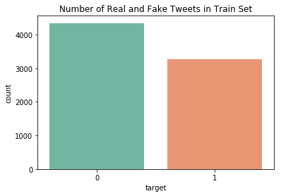


## Features
### Location


```python
print(f'Unique values in Location:\n\t{train["location"].nunique()} over {train["location"].notnull().sum()} nonmissing observations in Train Set and\n\t{test["location"].nunique()} over {test["location"].notnull().sum()} nonmissing observations in Test Set' )
```

    Unique values in Location:
    	3341 over 5080 nonmissing observations in Train Set and
    	1602 over 2158 nonmissing observations in Test Set


Location has about 33% observations without infomation. There are too many unique values comapring to number of observation.
Since location is less likely to have correlation with real or fake disaster tweets, it is safe to remove it from the analysis.

### Keyword


```python
print(f'Unique values in Keyword:\n\t{train["keyword"].nunique()} over {train["keyword"].notnull().sum()} nonmissing observations in Train Set and\n\t{test["keyword"].nunique()} over {test["keyword"].notnull().sum()} nonmissing observations in Test Set' )
```

    Unique values in Keyword:
    	221 over 7552 nonmissing observations in Train Set and
    	221 over 3237 nonmissing observations in Test Set


There are 221 keywords in the Training Set. Let's see how predictive they are.


```python
# Compute and sort real/fake ratio for each keyword
keyword_df = train[['id','keyword','target']].copy()
keyword_df['correct_pct'] = keyword_df.groupby('keyword')['target'].transform('mean')
keyword_df = keyword_df.drop_duplicates('keyword').sort_values('correct_pct', ascending=False)

# Plot top 50 keywords
fig = plt.figure(figsize=(8, 5), dpi=100)

ax = sns.barplot(y='keyword', x='correct_pct',data=keyword_df.iloc[:20])
ax.xaxis.set_ticks_position('top')
ax.set_title('Top 20 Real to Fake Tweet Ratio by Keywords ')
plt.show()

fig = plt.figure(figsize=(8, 5), dpi=100)
ax = sns.barplot(y='keyword', x='correct_pct',data=keyword_df.iloc[-20:])
ax.xaxis.set_ticks_position('top')
ax.set_title('Bottom 20 Real to Fake Tweet Ratio by Keywords ')
plt.show()
```


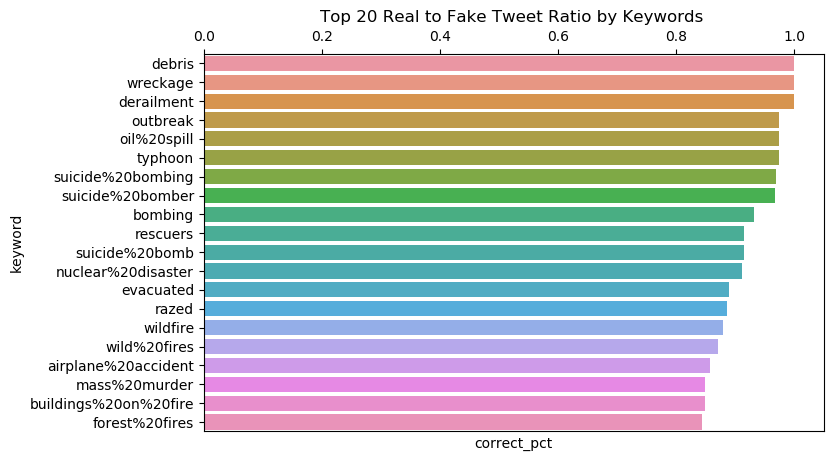


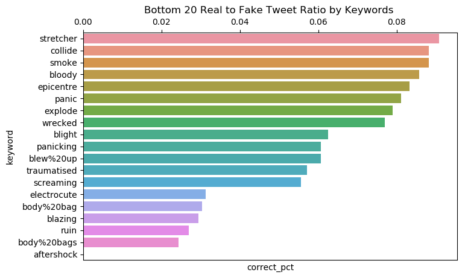


If a tweet has a keyword like __*debris, wreckage, derailment*__, it is highly to be a Real tweet.
On the other hand, if it has __*aftershock, body bags,*__ etc., it is more likely to be fake.

# Feature Engineering

## Text Cleaning

We will use **NLTK** and **Re** for cleaning the tweets and create some features.


```python
# Import NLTK package and Regex for cleaning
from nltk.corpus import stopwords
from nltk.tokenize import word_tokenize, sent_tokenize
from nltk.stem import WordNetLemmatizer
from nltk.tokenize import wordpunct_tokenize
import re

lemmatizer = WordNetLemmatizer().lemmatize   
stop_words = set(stopwords.words('english'))
```

First, we need to create some functions to do the tasks.
* *findkeyword* to find inputted charactor ( i.e #, @) in text then return 3 values: True if found the key, string after the key, number of key in text.
* *clean_text* to remove stopwords, links, mentions from tweets
* *addFeatures* create additional features from tweets such as word count, sentence count, ratio of capital letters.


```python
def findkeyword(keyword, text):
    key = keyword + '.*?( |$)'
    found = re.search(key, text)
    strings = re.findall(keyword + r'(\w+)', text)
    count = len(strings)
    return bool(found), ' '.join(strings), count

# Remove puntuation, url links, remove stopwords then tokenize text
def clean_text(text, fix_spelling=False):
    text = re.sub(r'http.*?( |$)', '', text)
    text = re.sub(r'@.*?( |$)', '', text)
    text = re.sub(r'[^(a-zA-Z)\s]','  ',text)
    #text = p.clean(text)
    text = text.lower()
    tokens = word_tokenize(text)
    if fix_spelling:
        tokenized = [lemmatizer(SpellChecker().correction(w)) for w in tokens if not w in stop_words]
    else:
        tokenized = [lemmatizer(w) for w in tokens if not w in stop_words]
    return ' '.join(tokenized)

def addFeatures(data):
    df = data.copy()
    df['clean_text'] = df['text'].map(clean_text)
    df['Char_Count_raw'] = df['text'].map(len)
    df['Word_Count_raw'] = df['text'].map(lambda x: len(word_tokenize(x)))
    df['Sent_Count_raw'] = df['text'].map(lambda x: len(sent_tokenize(x)))
    df['Char_Count'] = df['clean_text'].map(len)
    df['Word_Count'] = df['clean_text'].map(lambda x: len(word_tokenize(x)))
    df['Sent_Count'] = df['clean_text'].map(lambda x: len(sent_tokenize(x)))
    df['CapRatio']=df['text'].map(lambda x: len(re.findall(r'[A-Z]', x))) / df['Char_Count_raw']
    df[['hasTag','hashtags','tags_count']] = df['text'].apply(lambda x: pd.Series(findkeyword('#',x)))
    df[['hasMention','mentions','mention_count']] = df['text'].apply(lambda x: pd.Series(findkeyword('@',x)))

    return df
```

## Tweets length, tags

Apply our changes to the Train Set then print the first 5 rows.


```python
train = addFeatures(train)
```

Test the text cleaning process


```python
for i in np.random.randint(train.shape[0], size=5):
    print(f'Raw: {train["text"][i]}.\nCleaned: {train["clean_text"][i]}\n')
```

    Raw: @CorleoneDaBoss there isn't anything there its desolate bc of its nature. The significance is that we were the first country to do it.
    Cleaned: anything desolate bc nature significance first country

    Raw: [Question] Is anybody else having this problem with the '7' circle in Epicentre? http://t.co/dsPWS6hJ8w.
    Cleaned: question anybody else problem circle epicentre

    Raw: MP trains derailment: ‰Û÷It‰Ûªs the freakiest of freak accidents‰Ûª:

    MP trains derailment: ‰Û÷It‰Ûªs the freakiest of ... http://t.co/uHXODSc7Wi.
    Cleaned: mp train derailment freakiest freak accident mp train derailment freakiest

    Raw: Roger Goodell's Fatal Mistake: Tom Brady An Innocent Man http://t.co/UCNcKrnLow.
    Cleaned: roger goodell fatal mistake tom brady innocent man

    Raw: #INCIDENT
    Crash in Pascoe Vale South outbound on Tullamarine Fwy (CityLink) near Moreland Rd. Vehicles off in emergency lane. No delays..
    Cleaned: incident crash pascoe vale south outbound tullamarine fwy ( citylink ) near moreland rd vehicle emergency lane delay


## Readability

We can also measure the readability of tweets. Readability is the ease with which a reader can understand a written text. There are several ways to measure it such as Fog Index, Flesch–Kincaid, Dale–Chall, McLaughlin’s SMOG. However,  I only use Fog Index as an example. Other methods are also in the **textstat** library.

Accoring to [Wikipedia](https://en.wikipedia.org/wiki/Gunning_fog_index):
> Fog index estimates the years of formal education a person needs to understand the text on the first reading. For instance, a fog index of 12 requires the reading level of a United States high school senior (around 18 years old). The test was developed in 1952 by Robert Gunning, an American businessman who had been involved in newspaper and textbook publishing

| Fog Index | Reading level by grade |
|-----------|------------------------|
| 17        | College graduate       |
| 16        | College senior         |
| 15        | College junior         |
| 14        | College sophomore      |
| 13        | College freshman       |
| 12        | High school senior     |
| 11        | High school junior     |
| 10        | High school sophomore  |
| 9         | High school freshman   |
| 8         | Eighth grade           |
| 7         | Seventh grade          |
| 6         | Sixth grade            |

Install and import **textstat**


```python
!pip install textstat
import textstat
```

    Requirement already satisfied: textstat in /opt/conda/lib/python3.6/site-packages (0.6.0)
    Requirement already satisfied: pyphen in /opt/conda/lib/python3.6/site-packages (from textstat) (0.9.5)


Create a new feature *readability*  using strings from *text* feature.


```python
train['readability'] = train['text'].apply(lambda x: round(textstat.gunning_fog(x)))
```

Let's use violin plots  to compare *readability* distribution across different Real and Fake tweets.


```python
plt.figure(figsize=(10,8))
sns.violinplot(x='target', y='readability', data=train, palette='Set2')
ax.set_title("Readability for each class", fontsize=15);
```


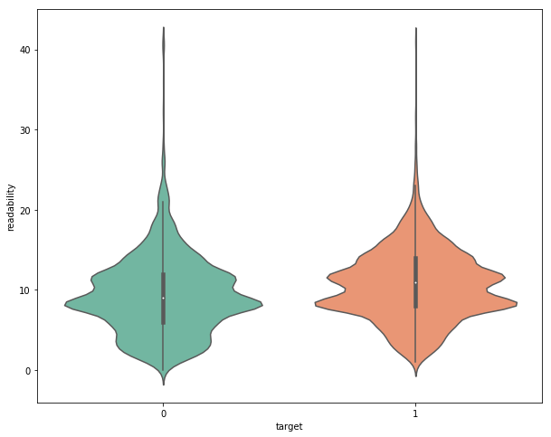


From the plot, the real tweets have a litte bit higer means of readability. They have similar distribution. 9 is the highest frequency in both groups, but for values larger than 9,Real tweets have higher frequentcies.

Readability's values over 20 are potential outliers since 20 equivalent to master graduate. It's difficult to believe that a tweet need PhD level reading skill to understand.

We can also look at a scatter plot below to see that there are no correlation between *readability* and *word count* and no apparent differences in distributions between Real and Fake tweets .


```python
train_sample = train.sample(1000)

fig = plt.figure(figsize=(10, 6), dpi=100)
ax = sns.scatterplot(x="Word_Count_raw", y="readability", data=train_sample,  hue='target', palette='Set2',  alpha=.8)
```


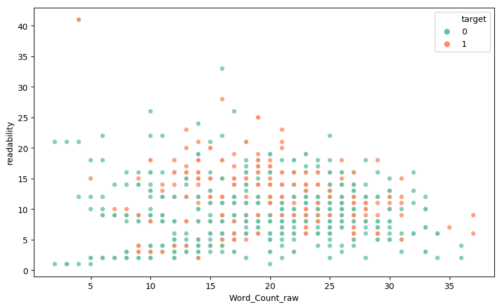


# EDA
## Basic


```python
fig = sns.FacetGrid(train, col="target")
fig.map(plt.hist, "Word_Count_raw", bins=30);
```


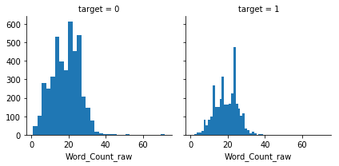


With the histograms we can see the shape of number of words's distribution but it's difficult to compare between real and fake distribuions. Hence, we can plot boxplots to make the comparisons.


```python
fig, ax = plt.subplots(3, 1, figsize=(10,20))

sns.boxplot(x='target', y='Word_Count_raw', data=train, ax=ax[0], palette='Set2')
ax[0].set_title("Number of words in each class", fontsize=15)

sns.boxplot(x='target', y='Char_Count_raw', data=train, ax=ax[1], palette='Set3')
ax[1].set_title("Number of letters in each class", fontsize=15)

sns.boxplot(x='target', y='CapRatio', data=train, ax=ax[2], palette='Set1')
ax[2].set_title("Ratio of capital letters in each class", fontsize=15);
```


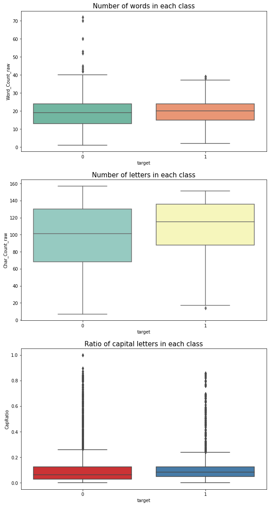


From boxplos above, we can see that number of words and ratio of capital letter in Real and Fake tweets are similar.
The number of letters in Real tweets are litter bit higher than Fake's.

## Correlation Table

We can create a corrlation table then use **Seaborn HeatMap** to graph it.
Based on the heatmap, we can see that *Char_Count_raw* which is the number of letter in original tweets is higly correlated with word count and sentence count.


```python
num_cols = ['target','Char_Count_raw', 'Word_Count_raw', 'Sent_Count_raw', 'Char_Count',
            'Word_Count', 'Sent_Count', 'CapRatio', 'tags_count',  'mention_count']

# Compute the correlation matrix
corr = train[num_cols].corr()

# Generate a mask for the upper triangle
mask = np.zeros_like(corr, dtype=np.bool)
mask[np.triu_indices_from(mask)] = True

# Set up the matplotlib figure
fig, ax = plt.subplots(figsize=(11, 9))

# Generate a custom diverging colormap
cmap = sns.diverging_palette(250, 10, as_cmap=True)

# Draw the heatmap
sns.heatmap(corr, mask=mask, cmap=cmap,  center=0,
            square=True, linewidths=.5, cbar_kws={"shrink": .5});
```


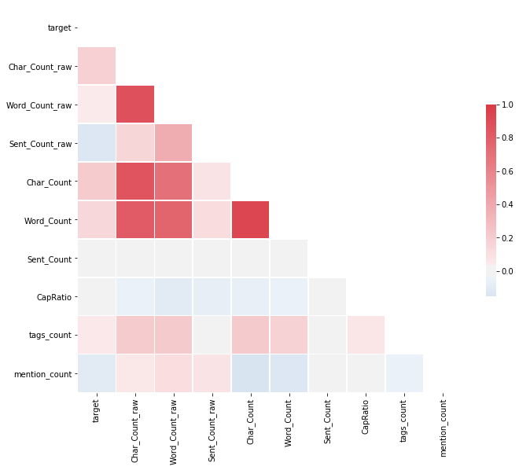


## WordCloud

Create a word cloud of our cleaned text using **wordcloud**. First, we need to merge all strings in *train['clean_text']* into one. Then, we can use wordcloud to generate a graph.


```python
# Import wordcloud
from wordcloud import WordCloud

# Join text
realtw = train[train['target']==1]
faketw = train[train['target']==0]
text = ' '.join(realtw['clean_text'].values.tolist())

# Create wordcloud
wordcloud = WordCloud(max_font_size=100, max_words=150,font_step=2,
                      background_color=None, mode='RGBA',colormap ='viridis',
                      min_word_length =4, width=1200, height=600).generate(text)

# Display
plt.figure(figsize=(16,8))
plt.imshow(wordcloud, interpolation='bilinear')
plt.axis("off")
plt.title('Wordcloud of Real Tweets\n', fontdict = {'fontsize' : 30})
plt.show()
```


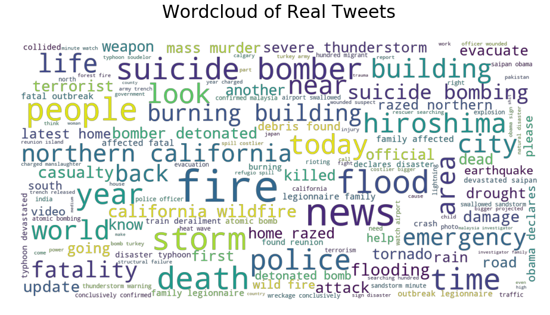


Similarty, we can create a wordcloud for fake tweets.


```python
text = ' '.join(faketw['clean_text'].values.tolist())

# Create wordcloud
wordcloud = WordCloud(max_font_size=100, max_words=150,font_step=2,
                      background_color=None, mode='RGBA',colormap ='viridis',
                      min_word_length =4, width=1200, height=600).generate(text)

# Display
plt.figure(figsize=(16,8))
plt.imshow(wordcloud, interpolation='bilinear')
plt.axis("off")
plt.title('Wordcloud of Fake Tweets\n', fontdict = {'fontsize' : 30})
plt.show()
```


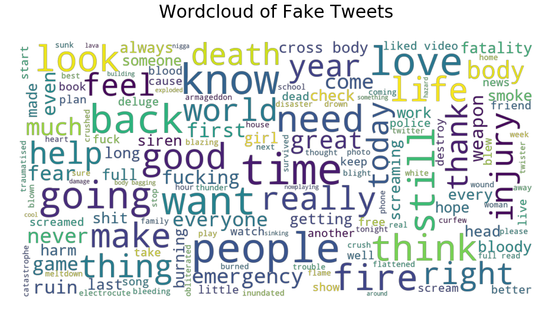


We can see in the Real Tweet wordcloud, some words such as *fire, flood, storm, news, fatality* appear.

# Models
## Preprocessing

In this second part, we will build a classification model using Logistic Regression and Recurrent Neural Net(RNN) with Long short-term memory(LSTM) and Glove.
However, we need to transform our data so we can feed it to our models.

Below function is used to transform a dataset to usable format. It drops irrelevant columns, apply the clean_text function to the text column, seperate feature and label columns then return features and label dataframes.


```python
def transform_data(data, text_col, label):
    x = data[text_col]
    if label in data:
        y = data[label]
    else:
        y = None
    return x, y
```

Transform train and test dataframes


```python
X, y = transform_data(train, 'text','target')
X_test, _ = transform_data(test, 'text','target')
```

Split X into train and validation sets using **scikit-learn**


```python
from sklearn.model_selection import train_test_split
X_train, X_valid, y_train, y_valid = train_test_split(X, y, random_state = 777, test_size = 0.2)
```

## Regression Models

Import relevant packages


```python
from sklearn.feature_extraction.text import TfidfVectorizer
from sklearn.linear_model import LogisticRegression, RidgeClassifier
from sklearn.metrics import f1_score
from sklearn.model_selection import cross_val_score
```

Since machine learning models work with numbers, we first need to transform our text to numbers.
In this case, I use TF-IDF, which short for term frequency-inverse document frequency, measures relevant a word is to a document in a collection of documents (corpus).
It multiplies two metrics: frequency of a word in a document, and the inverse document frequency of the word in a corpus.


```python
tfidf_vec = TfidfVectorizer(stop_words='english', ngram_range=(1,3))
tfidf_vec.fit_transform(X_train.values.tolist())
X_train_tfidf = tfidf_vec.transform(X_train.values.tolist())
X_valid_tfidf = tfidf_vec.transform(X_valid.values.tolist())
```

### Train Model

We use Ridge and Lasso regression to fit our data. Ridge and Lasso regression regularize our model's coefficients to reduce overfitting. The estimated coefficients are pushed towards 0, to make them work better on new data-sets.


**Lasso Regression**


```python
# Fit model
lasso_clf = LogisticRegression(penalty='l1', solver='liblinear')
```

**Ridge Regression**


```python
ridge_clf = RidgeClassifier()
```

### Model Validation

We use cross-validation. With *cv=5* the train set is divided into 5 parts, we train on 4 parts, then validate it with the rest. We also use F1 as the validation metric.


Here we can use F1 score to measure the accuracy of our model. F1 score considers both the precision and the recall of the test to compute the score.


```python
print("Lasso model's F1 Score:", cross_val_score(lasso_clf, X_train_tfidf, y_train, cv=5, scoring="f1"))
print("Ridge model's F1 Score:", cross_val_score(ridge_clf, X_train_tfidf, y_train, cv=5, scoring="f1"))
```

    Lasso model's F1 Score: [0.57788347 0.61556604 0.60071514 0.56834532 0.6013986 ]
    Ridge model's F1 Score: [0.6737338  0.7309417  0.7208238  0.69756663 0.66823529]


We can see that the ridge regression return higher F1 score comparing to Lasso. Let's fit the ridge model on whole training set and see how well it performs on validation data.


```python
ridge_clf.fit(X_train_tfidf, y_train)
pred_ridge = ridge_clf.predict(X_valid_tfidf)
f1_score(y_valid, pred_ridge)
```


    0.741132075471698


## RNN

Let's use Recurrent Neural Network to see if it perform better in the classication task.

### Preprocessing

Set up Hyperparameters


```python
vocab_size = 100000      # max number of words for tokenizer
max_length = 200         # max length of a sentence
embedding_dim = 100      # embedding dimensions for GloVe
glove_data = "../input/glove-global-vectors-for-word-representation/glove.twitter.27B."+str(embedding_dim)+"d.txt"
```

Import **tensorflow** tools for preprocessing and create word vector..

We tokenize all tweets in training using the *fit_on_texts()* with a tokenizer with vocabulary size(*vocab_size*) 100000, and out of vocab token(*oov_token*) 'oov'.

Then we use *text_to_sequences()* to encode tweets in the numeric format.

We transform all inputs into a same length because the inputs have different length so to put a batch in the RNN. We apply the padding to the end of the sequence by specify *padding_type='post'*. Futhermore, we also need to trim long inputs by removing extra words from the end of the sequences  by using *trunc_type='post'*.


```python
from tensorflow.keras.preprocessing.text import Tokenizer
from tensorflow.keras.preprocessing.sequence import pad_sequences

def padding_text(X,vocab_size,max_length,padding_type='post',trunc_type='post'):
    corpus = X.values.tolist()
    X_seq = tokenizer.texts_to_sequences(corpus)
    X_padd = pad_sequences(X_seq, maxlen= max_length, padding=padding_type, truncating=trunc_type)
    return X_padd
```


```python
corpus_train = X_train.values.tolist()
tokenizer = Tokenizer(num_words=vocab_size, oov_token='<oov>')
tokenizer.fit_on_texts(corpus_train)
word_index = tokenizer.word_index
print('Vocabulary size:', len(word_index))

# Padding Text
X_train_padd = padding_text(X_train,vocab_size,max_length)
X_valid_padd = padding_text(X_valid,vocab_size,max_length)
X_test_padd = padding_text(X_test,vocab_size,max_length)

print('Shape of train set tensor:', X_train_padd.shape)
print('Shape of train label tensor:', y_train.shape)
print('Shape of validation set tensor:', X_valid_padd.shape)
print('Shape of validation label tensor:', y_valid.shape)
```

    Vocabulary size: 19397
    Shape of train set tensor: (6090, 200)
    Shape of train label tensor: (6090,)
    Shape of validation set tensor: (1523, 200)
    Shape of validation label tensor: (1523,)


Load Glove from txt file and process Embedding Matrix


```python
embeddings_index = {}

f = open(glove_data)
for line in f:
    values = line.split()
    word = values[0]
    embeddings_index[word] = np.asarray(values[1:], dtype='float32')
f.close()

embedding_matrix = np.random.random((len(word_index) + 1, embedding_dim))

for word, i in word_index.items():
    embedding_vector = embeddings_index.get(word)
    if embedding_vector is not None:
        embedding_matrix[i] = embedding_vector
print("Done!")
```

    Done!


Since F1 score is not supported in model.compile, we need to create F1 score function for model metric which is based on old keras source code.


```python
import keras.backend as K

def f1_score_keras(y_true, y_pred):
    true_positives = K.sum(K.round(K.clip(y_true * y_pred, 0, 1)))
    possible_positives = K.sum(K.round(K.clip(y_true, 0, 1)))
    predicted_positives = K.sum(K.round(K.clip(y_pred, 0, 1)))
    precision = true_positives / (predicted_positives + K.epsilon())
    recall = true_positives / (possible_positives + K.epsilon())
    f1_val = 2*(precision*recall)/(precision+recall+K.epsilon())
    return f1_val
```

    Using TensorFlow backend.


### Train Model

The layers in our model are as follows.

+ Embedding layer: to map each input word to a 100 dimensional vector and use pre-trained weights from GloVe.
+ Bidirectional: to enable latter words impact the earlier words in a tweet
+ LSTM: to remedy vanishing gradient problem, with dropout to prevent overfitting.
+ Dense: layer with relu activation. This adds additional representational capacity to the network.
+ Dropout: a regularization method to reduce overfitting and improving model performance.
+ Dense: output layer with sigmoid activation function since this is a binary classification problem

The model is compiled with the ***Adam optimizer*** and trained using the ***binary_crossentropy*** loss using ***F1 score*** as metric.


```python
import tensorflow as tf
from tensorflow.keras.layers import Embedding, Bidirectional, Dropout, Dense, LSTM

def create_model():
    model = tf.keras.Sequential([
        Embedding(len(word_index) + 1, embedding_dim,weights = [embedding_matrix],
                input_length=max_length, trainable=False),
        Bidirectional(LSTM(128, dropout=0.2)),
        Dense(64, activation='relu'),
        Dropout(0.5),
        Dense(1, activation='sigmoid')
    ])
    return model

model = create_model()
model.compile(loss='binary_crossentropy',optimizer='adam',metrics=[f1_score_keras,'accuracy'])
```


```python
num_epochs = 10
blackbox = model.fit(X_train_padd, y_train, epochs=num_epochs, validation_data=(X_valid_padd, y_valid))
```

    Train on 6090 samples, validate on 1523 samples
    Epoch 1/10
    6090/6090 [==============================] - 9s 2ms/sample - loss: 0.5143 - f1_score_keras: 0.6707 - accuracy: 0.7562 - val_loss: 0.4732 - val_f1_score_keras: 0.7078 - val_accuracy: 0.7846
    Epoch 2/10
    6090/6090 [==============================] - 5s 811us/sample - loss: 0.4466 - f1_score_keras: 0.7443 - accuracy: 0.8046 - val_loss: 0.4699 - val_f1_score_keras: 0.7362 - val_accuracy: 0.7971
    Epoch 3/10
    6090/6090 [==============================] - 5s 815us/sample - loss: 0.4355 - f1_score_keras: 0.7524 - accuracy: 0.8123 - val_loss: 0.4607 - val_f1_score_keras: 0.7266 - val_accuracy: 0.7932
    Epoch 4/10
    6090/6090 [==============================] - 5s 815us/sample - loss: 0.4157 - f1_score_keras: 0.7659 - accuracy: 0.8187 - val_loss: 0.4688 - val_f1_score_keras: 0.7218 - val_accuracy: 0.7925
    Epoch 5/10
    6090/6090 [==============================] - 5s 835us/sample - loss: 0.4015 - f1_score_keras: 0.7706 - accuracy: 0.8248 - val_loss: 0.5151 - val_f1_score_keras: 0.7024 - val_accuracy: 0.7892
    Epoch 6/10
    6090/6090 [==============================] - 5s 818us/sample - loss: 0.3860 - f1_score_keras: 0.7808 - accuracy: 0.8305 - val_loss: 0.4834 - val_f1_score_keras: 0.7403 - val_accuracy: 0.8017
    Epoch 7/10
    6090/6090 [==============================] - 5s 832us/sample - loss: 0.3777 - f1_score_keras: 0.7778 - accuracy: 0.8299 - val_loss: 0.4612 - val_f1_score_keras: 0.7434 - val_accuracy: 0.7991
    Epoch 8/10
    6090/6090 [==============================] - 5s 803us/sample - loss: 0.3613 - f1_score_keras: 0.8002 - accuracy: 0.8461 - val_loss: 0.4601 - val_f1_score_keras: 0.7419 - val_accuracy: 0.7965
    Epoch 9/10
    6090/6090 [==============================] - 5s 810us/sample - loss: 0.3353 - f1_score_keras: 0.8069 - accuracy: 0.8524 - val_loss: 0.4863 - val_f1_score_keras: 0.7290 - val_accuracy: 0.7971
    Epoch 10/10
    6090/6090 [==============================] - 5s 811us/sample - loss: 0.3273 - f1_score_keras: 0.8169 - accuracy: 0.8604 - val_loss: 0.4912 - val_f1_score_keras: 0.7418 - val_accuracy: 0.8024


### Model Validation


```python
model_loss = pd.DataFrame(blackbox.history)
model_loss.head()
```


<div>
<style scoped>
    .dataframe tbody tr th:only-of-type {
        vertical-align: middle;
    }

    .dataframe tbody tr th {
        vertical-align: top;
    }

    .dataframe thead th {
        text-align: right;
    }
</style>
<table border="1" class="dataframe">
  <thead>
    <tr style="text-align: right;">
      <th></th>
      <th>loss</th>
      <th>f1_score_keras</th>
      <th>accuracy</th>
      <th>val_loss</th>
      <th>val_f1_score_keras</th>
      <th>val_accuracy</th>
    </tr>
  </thead>
  <tbody>
    <tr>
      <th>0</th>
      <td>0.514281</td>
      <td>0.670658</td>
      <td>0.756158</td>
      <td>0.473221</td>
      <td>0.707818</td>
      <td>0.784636</td>
    </tr>
    <tr>
      <th>1</th>
      <td>0.446614</td>
      <td>0.744302</td>
      <td>0.804598</td>
      <td>0.469915</td>
      <td>0.736200</td>
      <td>0.797111</td>
    </tr>
    <tr>
      <th>2</th>
      <td>0.435520</td>
      <td>0.752418</td>
      <td>0.812315</td>
      <td>0.460656</td>
      <td>0.726574</td>
      <td>0.793171</td>
    </tr>
    <tr>
      <th>3</th>
      <td>0.415742</td>
      <td>0.765947</td>
      <td>0.818719</td>
      <td>0.468775</td>
      <td>0.721848</td>
      <td>0.792515</td>
    </tr>
    <tr>
      <th>4</th>
      <td>0.401541</td>
      <td>0.770598</td>
      <td>0.824795</td>
      <td>0.515082</td>
      <td>0.702413</td>
      <td>0.789232</td>
    </tr>
  </tbody>
</table>
</div>


```python
model_loss.plot(ylim=[0,1], figsize=(10,8));
plt.title('Model accuracy');
plt.xlabel('epoch');
```


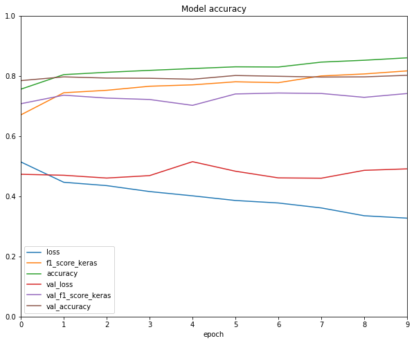


First, we can see that loss on training set decrease as number of epoch increase while loss on validation set decrease then increase. This is a sign of overfitting.
Second, validation accuracy is lower than training which also indicate overfitting.
To fix this, we can try to reduce number of training epochs, increase sample size, increase dropout rate.

Nevertheless, let's see how our model performs.


```python
pred = model.predict_classes(X_valid_padd)
f1_score(y_valid, pred)
```


    0.7534807534807535


Compare to Ridge regression, RNN model performs better but only by a small amount. Since we can see that the RNN is overfitted, after modifing the model, we can expect the RNN will be better significantly. The next part of this project will be on improving the RNN and optimize hyperparameters using Bayesian Optimization.


```python

```
